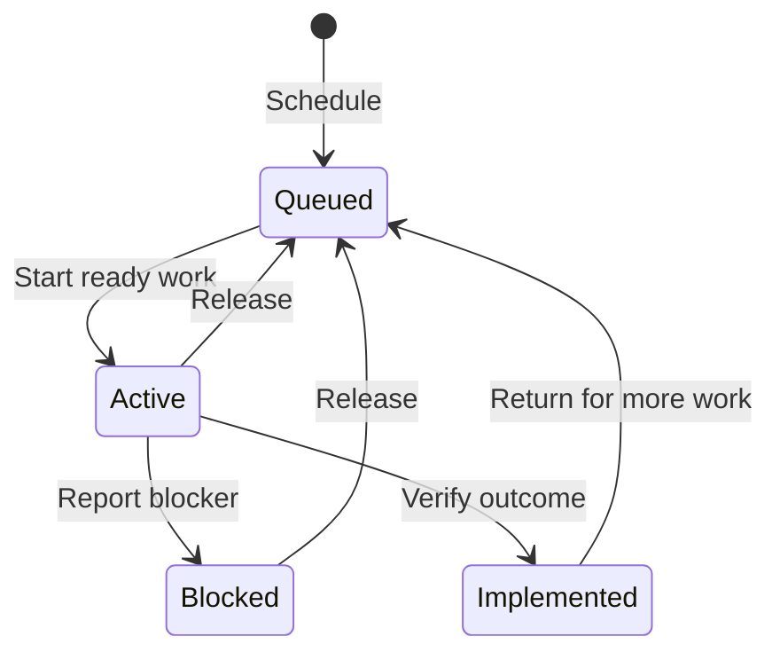

# ADR-7: Task workflow and local queue

Human plan approval and outcome acceptance follow workbench:ADR-7. Queue selection and ordering are personal execution
choices; neither grants approval. Protected-document acknowledgment remains a separate decision under ADR-6.

Task workflow views distinguish initial and revised approval, approved work and its progress, and outcomes awaiting
human acceptance. Plans includes numbered tasks awaiting revised approval. These tasks retain their identity, queue
position, and completed work. Keep record browsing separate from this workflow.

Present revised approvals for started work ahead of initial approvals. Keep started tasks awaiting approval visible in
Work. Append newly authorized work, including requested project reviews, to the end of the local queue. Resume eligible
started work first and preserve queue order within each priority unless the developer directs independent work.

Present completed tasks with their associated record changes in one review entry. Bind each human decision to the
version reviewed. Retain the source of developer-requested review authorization separately from plan approval and
outcome acceptance.

The browser provides human decisions and queue ordering, with execution progress and blockers shown for inspection.
Executing agents maintain local progress. Workbench identifies blockers from recorded prerequisites.

Optional personal planning storage keeps future plans outside implementation history. Edits remain durable drafts until
an explicit checkpoint or approval; neither publishes them. Named plans receive numeric task identities when work
starts. Transfer the selected plan and its necessary context without starting unrelated work, preserving approval,
relationships, and supporting material. Retire saved copies only after verifying their first implementation commit.

Planning history stays outside implementation ancestry. Only its explicitly configured publication destination receives
planning-only history without implementation publication gates. Empty planning storage may be pruned only while
preserving drafts, queued work, unfinished transfers, and checkpoints awaiting manual publication.

Cancellation retains its reason. Deletion protects published history, incoming relationships, and unrelated work;
reversion preserves the original work and adds an inverse change. Consequential operations provide an inspectable plan
and recoverable results.

Local execution queues retain order, active work, and progress. Keep that state separate from tracked task records and
human decisions, preserving it across cache cleanup and service restarts. CLI and browser operations use the same queue,
readiness rules, and human decisions. Queue operations coordinate work without launching agents or creating commits.

Execution states remain local; acceptance and cancellation follow the shared task lifecycle.

A queued task is ready when its current scope is authorized and its prerequisites are satisfied. Implementation evidence
applies to the plan and source version actually verified. It establishes implementation at that version, without
verifying later edits or granting human acceptance.

Plan approval applies to the approved plan version, independently of the executing agent or checkout. Delegated agents
may use that approval within its authorized scope. Execution assignments and progress remain separate from human
approval and acceptance.

Retain the approved plan and supporting files so revised plans can be compared and approved without discarding active
work. Formatting, implementation accounts, and checklist progress do not by themselves change the approved scope.
Renaming a future plan preserves its meaning, approval, relationships, and queue position.

Outcome review compares the complete task record with its most recently approved plan, including checklist completion
and implementation-account updates. Approving a revised plan advances that comparison baseline without accepting the
outcome.

Reconcile record identities during integration without transferring approval to unrelated work. Preserve mechanical
renumbering only when meaning and relationships remain unchanged; changed implementation contexts require renewed
applicable review and verification.

Reject stale task and queue updates and conflicting starts of the same queued task. Recovery restores consistency
between task records, human decisions, and local queue progress without overwriting intervening user edits or newer
human decisions.

Rationale: Persistent local coordination supports work across sessions without turning execution bookkeeping into shared
project history. Distinct human decisions and version-bound evidence prevent queue activity from implying approval or
acceptance.
