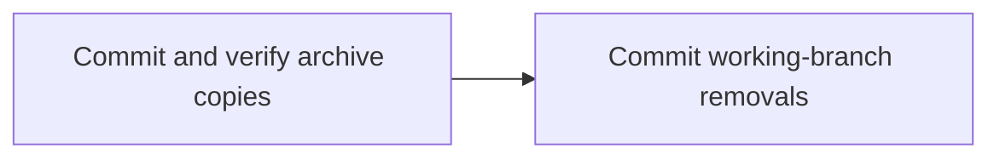
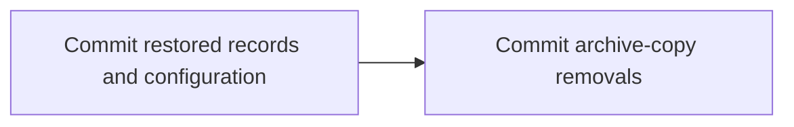

# TSK-0: Optional Git-backed archives for completed records

## Review summary

Optionally move completed records to a configured Git archive branch, reducing checked-out files while preserving UI,
CLI, agent access, and search. Read and search archived records without restoring files to the working tree.

Archival is disabled by default and intended for projects with large record histories. Ordinary projects keep their
records on disk without archive configuration.

Archive only Accepted or Canceled tasks and completed, human-reviewed experiments, including rejected and inconclusive
results. Keep ADRs, environments, citations, and releases live.

**Archive a completed batch**



**Disable archival**



### CLI workflow and configuration

Manage enabling, batch archival, status/recovery, and disabling through the CLI under `workbench record archive`.
Enabling selects the archive branch and group size. Each explicit archive operation previews eligible groups and creates
two commits: first add the records and supporting files to the archive branch, verify them, then remove them from the
working branch. Keep these commits separate from the implementation or experiment commits being archived. Retries reuse
completed steps.

Disabling reverses the transfer in two commits: restore and verify the archived records on the working branch and commit
them with the configuration change, then commit removal of those copies from the archive branch. Preserve the archive
history. Conflicting files block completion. Changing the archive destination likewise requires a verified transfer or
restoration. Re-enabling archival extends the existing archive history.

Rebasing or squashing implementation commits leaves archived records and archive history unchanged.

Protect the archive branch through Workbench operations and applicable Git hooks. Reject unmanaged record edits, history
rewrites, and branch deletion; allow verified archival and restoration-cleanup commits that extend its history. Retain
these protections after disabling archival. Document local hook coverage and bypass limits; repositories may add
server-side branch protection.

The proposed default branch name and group size are:

```toml
[records]
archive_branch = "workbench/archive"
archive_group_size = 1296
```

These choices live in tracked project configuration. Workbench stores the selected archive commit as `archive.revision`
in the repository's tracked `workbench/state.toml`. The removal commit updates that value; disabling clears it when the
restored records are committed. Older branches retain their recorded archive revision.

The branch is configurable; group size accepts any positive integer. Group fixed numeric ID ranges separately for each
scope and record type. At the default size, the first ranges are `0–ZZ`, then `100–1ZZ`. Every existing record in a
selected range must be eligible; unused IDs need not be filled. Keep the incomplete final range live unless the user
explicitly includes it. A range is complete when the highest existing ID in that scope and record type reaches or passes
its upper bound.

No archive is configured by default. Clearing its setting manually must report any required restoration or incomplete
transfer. The archive cannot be an active development branch.

Use one configured integration target. Recommend the selected remote's default branch; when unavailable, suggest an
existing `main`, then `master`. Resolve ambiguous remotes or branches with the developer and retain the selected target
rather than silently changing it. Only the configured integration branch may initiate archival.

Archiving creates local commits; publication requires an explicit request. Publish archive and integration updates
atomically where supported. Otherwise, publish and verify the archive before publishing working-branch removals.
Disabling publishes restored records before archive-copy removals. Keep both branches on the configured integration
remote when publishing; local archival does not require a remote.

Archive-aware CLI rebase and merge operations preserve archive references and reconcile live and archived records as
branch histories combine. Matching skills use the CLI for coordination and recovery and guide semantic conflict
resolution and review.

```text
workbench rebase [target]
workbench merge <source>
```

Rebase defaults to the configured integration target. Both commands require a clean checkout, preserve a recovery
reference, stop for conflicts, and support explicit continuation or abortion. They run without requiring or launching an
agent; a human or agent can resolve conflicts and continue. Successful execution and validation do not establish
semantic review or grant human approval.

### Delivery checklist

- [x] Establish shared integration-target configuration and Git-backed archived-record access.
- [x] Implement the archive CLI's resumable enable, transfer, recovery, and restore workflows.
- [x] Integrate archived history, search, references, and supporting files into CLI, agent context, and browser views.
- [x] Add archive-aware CLI rebase/integration operations and update the supplied rebase skill to use them.

## Implementation account

Workbench starts archival only from the configured integration branch. Each checkout reads the archive commit recorded
in its state file, so later transfers leave older checkouts readable. Workbench looks up live and archived records
together, reports conflicting copies, and preserves IDs, contents, and file permissions. The CLI and browser can search
records and open supporting files without restoring them to disk.

Workbench verifies the destination before removing source copies during archival or restoration. It keeps both commits
recoverable until the transfer finishes and preserves unrelated edits and reviews of unchanged records. The archive
branch stays protected after archival is disabled.

The rebase and merge commands check for record conflicts that Git's text merge can miss. They retain archive history and
can update an outdated archive pointer when an existing archive commit contains the required records. The rebase skill
uses these commands.

Tests covered older archive commits after Git garbage collection, restricted clones, large archives and supporting
files, interruptions during transfer or push, and concurrent edits. Browser and CLI checks covered search,
prerequisites, and supporting files. Integration checks covered conflicts, resuming and aborting, and rebasing across
upstream renames and deletions.

## Implementing-agent detail

- Preserve Git checkout encodings and filters during transfers; coordinate index publication with ordinary Git writers.
  Bound disposable archive metadata caches and reuse validation of unchanged immutable objects. Keep archived records
  readable even when their indexes exceed the cache budget.

- Start the archive as an independent Git history whose first commit contains archived records and supporting files,
  without inheriting application history or requiring an empty starter commit.
- Use one logical record inventory for lookup, supporting-file reads, references, task relationships, allocation,
  validation, maps, and search. Preserve scoped IDs and canonical paths across both stores. Identical copies appear
  once; differing copies require resolution rather than silently choosing a version.
- Update `archive.revision` in the root `workbench/state.toml` with the working-branch removal commit, preserving record
  counters and other state. Coordinate these updates with record allocation so neither writer overwrites the other's
  changes. Read that revision rather than the moving archive tip. Restore the records referenced by the selected branch,
  not every historical version; clear the revision with the restoration commit. Preserve earlier archive revisions for
  older branches and checkouts through disabling and re-enabling archival.
- Transfer records and their owned supporting files from a validated source commit, preserving exact bytes, paths, and
  modes. Check eligibility against that snapshot, including required human review and task completion rules. Recheck
  branch revisions and affected working files before removal; preserve unrelated edits and stop on conflicting changes.
- Track unfinished operations durably across both commits and configuration changes. Coordinate writers across linked
  worktrees, and retain recovery state until completion. Status and validation identify incomplete steps; retries reuse
  verified work. Clearing configuration manually must not hide outstanding archive references or recovery state.
- Teach retention and review gates to verify both sides of a transfer. Unchanged transfers preserve record
  acknowledgments and acceptance; they do not represent document deletion or new authorship. Validate archive-only trees
  as record stores and validate integration changes against the combined inventory. Publication checks consider both
  proposed refs in an atomic push or verify the required counterpart is already published. Unverified record deletion
  remains blocked. Amend workbench:ADR-4 to permit these verified transfers.
- CLI rebase and merge operations check the combined record inventory even without textual conflicts. Preserve valid
  archive references; stop for conflicting record contents or missing revisions. Keep conflict resolution resumable and
  preserve the separate review requirements. Skills use these operations rather than duplicating their coordination.
- Read locally available archive objects without a service or checkout. Missing objects produce an explicit acquisition
  action, including fetching the archive branch and required history in restricted clones; an unavailable archive is
  never empty. Use disposable indexes keyed by archive revision and avoid replaying history for ordinary reads.
- Keep archived records available in completed history, search, references, and direct links without enumerating them
  all in active-work maps. Archive views remain read-only; edits and workflow transitions require explicit restoration.

### Verification

- Exercise real archive, restore, disable, and re-enable operations in disposable Git repositories. Verify exact record
  and supporting-file contents and modes, preserved acknowledgments, and CLI/browser access without restoring files for
  viewing. Projects without archival retain their existing behavior.
- Cover ID-range boundaries, gaps, group size one, partial groups, multiple scopes and record types, and ineligible
  records. Active tasks must still resolve archived parents and prerequisites; archived IDs must not be reallocated.
- Interrupt before and after either commit and during configuration updates. Test repeated recovery, changed source
  files, staged edits, concurrent worktrees, and conflicting copies; preserve data without duplicate commits.
- Exercise real hooks for verified transfers and ordinary deletions, archive edits, history rewrites, and branch
  deletion. Archive-only trees receive appropriate validation, and unchanged transfers require no duplicate document
  acknowledgment. Test atomic publication and either half of a sequential publication failing.
- Verify old branches can read their pinned archives after restoration, re-enabling, and Git garbage collection.
  Rewriting implementation commit IDs must not change archived contents or history. Disabled archival must not remove
  archive-history protection. Archive-state updates preserve concurrent record allocations and commit with the
  corresponding record removals or restoration.
- Cover local-only repositories, offline reads, and shallow or single-branch clones with missing archive objects. Verify
  explicit acquisition and consistent CLI/browser results, including a large archive without per-request history replay.
- Exercise conflict-free and conflicting rebases and merges, including a branch that edits a subsequently archived
  record. Verify recovery and standalone CLI use without an agent. Evaluate the updated skill separately through
  realistic agent runs.

### Alternative considered

Grouped branch archival preserves the current record mapping. The sparse-checkout alternative was investigated: cone
mode requires a project-wide inclusion list and retains ancestor files; a prototype left a new source directory hidden
after switching branches. This complicates using it as an exclusion-only mask.
