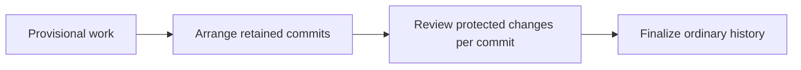

# TSK-1: Git-backed future plans and serialized task delivery

## Review summary

Keep future plans on a configurable Git planning branch, separate from implementation history. Edit, approve, and queue
named plans through the CLI or browser without switching branches. When approved work begins, assign its numeric task ID
and include the task record in its first implementation commit.

Review protected changes within each intended final commit, then finalize provisional history in order. This produces
ordinary reviewed implementation history while unrelated future plans remain separate and recoverable.

**Checkpoint plans**

**Finalize implementation**

### Plan storage and editing

Configure the planning branch and optional push destination locally. Suggest `workbench/plans` when enabling planning
storage; leave it disabled by default. Reuse TSK-0's integration-target configuration.

Read the planning branch's current tip without pinning a revision in project state. Create an independent Git history
whose first commit contains plans, without inheriting application history or requiring an empty starter commit.

Enable local auto-pruning by default, with an option to retain the branch. Prune only when both planning and execution
queues are empty and there are no local drafts, unfinished transfers, or planning updates awaiting a manual push.
Important decisions remain in the transferred task records. Remote changes remain manual. Recreate a deleted branch when
next needed; recover surviving copies or report missing referenced plans rather than silently losing them.

Edits remain durable local drafts. Create planning commits on explicit checkpoint requests and plan approval, grouping
related edits rather than committing every save or keystroke. Preserve earlier planning revisions through ordinary Git
history. The developer manually pushes the planning branch when wanted; saving and approval never push it.

Retain the exact approved plan and included supporting files, even before its first commit or with planning storage
disabled. Show changes since approval through the CLI and browser, using the existing document diff views. Allow review
and approval of a revised plan without manually returning it to planning first.

Only the configured planning destination receives the push exception. Validate its planning records and supporting
files, permitting plans awaiting approval but rejecting implementation and policy changes. Provisional implementation
commits remain local.

Plans have names unique within their scope. Renaming updates queue entries and relationships without adding another
persistent identifier. Queue selection, order, and execution progress remain local. Ordinary editor use on the planning
branch is supported; a separate worktree is optional.

Extend the existing task and queue commands for named plans, with an explicit checkpoint action. Use Git for manual
pushes rather than adding a separate backup workflow.

Starting work transfers only the selected approved plan, preserving its approval, supporting files, significant choices,
and relationships. The implementation copy becomes authoritative; retire the saved plan only after its first
implementation commit is verified. Starting a child preserves the context of its parent and leaves unrelated work in
planning. Existing task-account and acceptance rules continue under workbench:ADR-7.

Record when each plan was added and show the date in CLI and browser discovery. Preserve it through editing, renaming,
approval, and transfer into implementation; execution order remains explicit. Use recoverable saved-history evidence for
existing plans without inventing their first discussion dates.

### Commit review and history

Present each retained commit as its own review unit, compared with its parent. Uncommitted work is a separate captured
unit. Further edits within a unit compare with its most recent acknowledgment. Reviewing a later commit does not approve
earlier intermediate versions; discarded checkpoints do not each need review. Arrange the intended commit boundaries
before review, then finalize in parent order without provisional markers or approval-only commits. Preserve the actual
review evidence rather than backdating consent.

Extend TSK-0's rebase and merge operations to reconcile named-plan references, independently allocated task IDs, and
review evidence. Mechanical renumbering can preserve approval when identity and meaning are unchanged and affected
references are updated. Reuse receipts across rebases when the reviewed contents and comparison context remain
unchanged. Renew affected agent review and checks for a changed project snapshot; unrelated code edits do not invalidate
document acknowledgment.

Show pending human decisions across the project, with progress within the selected commit review set. Let the developer
inspect commits and diffs for feature branches or linear unpublished work without switching branches.

Canceling preserves the reason work stopped. Deleting previews and removes selected unpublished work; reverting retains
it and adds an inverse change. Preserve incoming relationships and unrelated work; mixed-task commits require explicit
separation before deletion.

### Delivery checklist

- [x] Add optional planning storage, durable drafts, explicit checkpoints, and approval checkpoints.
- [x] Integrate named plans with CLI/browser editing, approval diffs, queue ordering, and transfer into implementation.
- [x] Add per-commit review and finalization, extending rebase and merge coordination for plan and review continuity.
- [x] Validate planning pushes and provide unpublished-history inspection and cancel/delete/revert workflows.
- [x] Record and display Added at metadata, preserving it across plan and task transitions.

## Implementation account

Repository-local settings keep named plans in independent Git history. Git references protect draft saves through cache
cleanup and garbage collection. Explicit checkpoints group related edits, detect concurrent changes, and recover after
interruption. Plan approval retains the exact record and supporting files before implementation.

The CLI and browser expose named plans and their supporting files. Starting work assigns a numeric ID and transfers the
plan's approval and relationships. The planning copy stays in place until the first implementation commit is verified.
Renaming preserves approval and updates related plans and queue entries. Tests exercised transfers, interruption
recovery, and linked checkouts.

Retained commits have independent review units. Finalization preserves source and authorship and keeps the original
history recoverable. Accepted Git history preserves unchanged comparison authority in clones without private receipts.
Mechanical renumbering preserves approval when identity and meaning are proven unchanged. Immutable comparisons are
cached separately from live review decisions. Verification exercised browser progression and review continuity across
clones and rebases.

The CLI creates and checkpoints plans. The browser edits and reviews existing plans, with queue controls attached to the
task they affect. Task outcome pages link to related document reviews and delivered commits across scopes. Cancellation
keeps a supplied reason, deletion previews affected unpublished work, and reversion prepares an inverse for renewed
review.

The planning-only push exception applies to the configured destination. Cleanup preserves unpushed checkpoints and
unfinished work. Existing plans moved into named storage with their order and supporting material intact. Tests
exercised publication boundaries, pruning, and interrupted deletion.

Plans awaiting approval are sorted by date added. Approval appends work to the local queue, and reapproval preserves
position and progress. Renaming and transfer preserve the recorded creation date. The browser shows readiness and
progress. The CLI handles claiming work and recording implementation.

## Implementing-agent detail

- Reuse TSK-0's Git-backed inventory. Resolve one logical record across drafts, planning, implementation, and archive
  storage, with explicit authority during transfers. Keep planning commits outside implementation ancestry. Missing
  objects and failed reads must not appear as empty lists.
- Keep drafts outside disposable caches and preserve them across service restarts. Checkpoint records, supporting files,
  relationships, and human decisions together. Recheck approval and prerequisites before starting work. Retain
  recoverable transfer state until the implementation commit and planning update are both verified.
- Protect unrelated task decisions during deletion and reversion. Keep review traversal within the selected scope. Reuse
  bounded immutable history inspections and validation while refreshing live acknowledgment state. Expose retained
  recovery references for explicit cleanup, protecting unfinished operations.
- Detect concurrent changes when updating drafts, queues, or Git references. Coordinate checkpoints with checkouts of
  the planning branch, preserving pending files and index changes and rejecting conflicting updates. Keep original
  history recoverable until replacement history is verified and activated. CLI operations remain usable without a
  service.
- Reconcile identities and references during rebase or merge even without textual conflicts. Preserve review evidence
  only for the contents and comparison context actually reviewed. Stop for ambiguous collisions, conflicting copies, or
  changed policy meaning. Update affected shared and application ADRs with the accepted review and storage concepts;
  keep command syntax and procedures in documentation.

### Verification

- Exercise draft editing, grouped checkpoints, approval, recovery, and manual pushes through real repositories and
  remotes. Cover concurrent writers, interrupted saves, direct editor changes, and Git garbage collection; routine edits
  must not create commits or push.
- Cover missing local and remote branches, recreation, surviving copies, and references to missing plans. Preserve local
  drafts and avoid restoring outdated remote plans over newer implementation work.
- Start whole plans and individual children. Verify exact contents, supporting files, relationships, numeric allocation,
  queue order, and approval continuity. Preserve unrelated plans and recover interrupted transfers.
- Exercise approval diffs before the first commit and with planning storage disabled, updated approval, and supporting
  file changes. Verify the retained baseline and preserve concurrent edits and active work.
- Exercise renamed plans, numeric collisions, rebases, merges, amendments, and squashes. Verify commit review
  boundaries, renewed evidence where required, recoverable finalization, and implementation history without
  planning-only commits.
- Reject implementation changes through the planning-push exception. Cover mismatched destinations, concurrent remote
  updates, rejected pushes, and offline use.
- Verify cancel, delete, and revert have distinct outcomes and preserve published history and unrelated work. CLI and
  browser discovery, counts, readiness, review progress, and history must agree.
