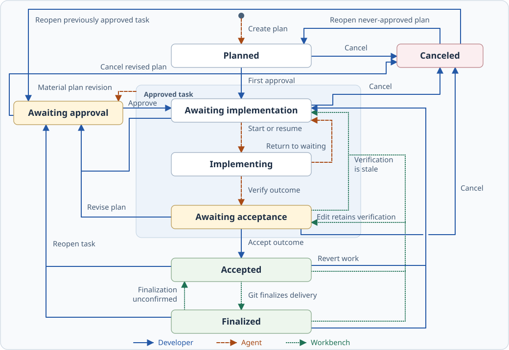
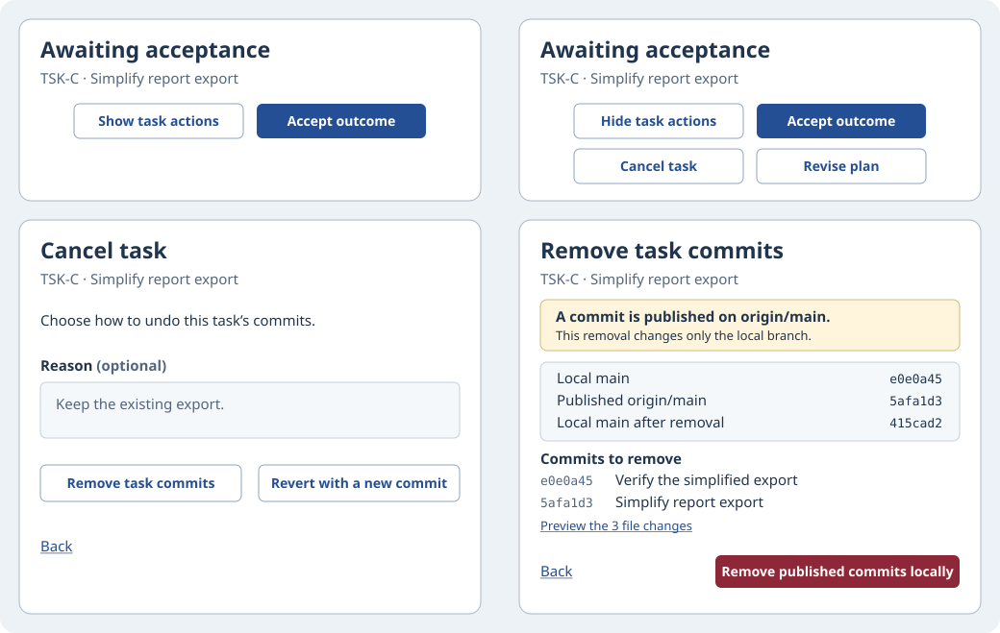
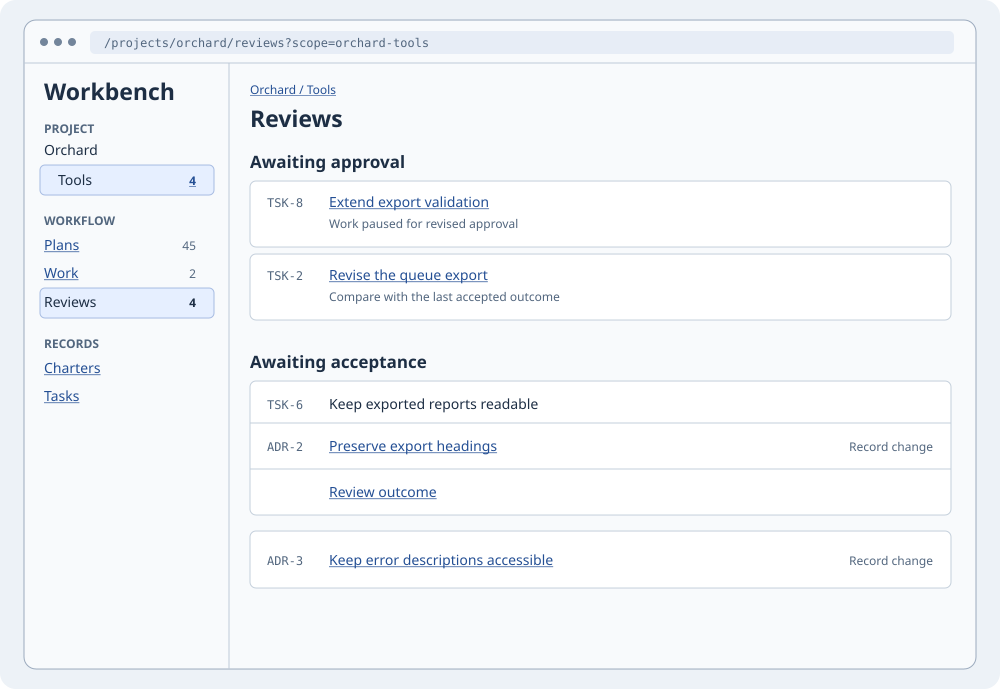

# TSK-2: Separate plans, work, and reviews in the browser workflow

## Review summary

Use **Plans** for the backlog, **Work** for the implementation queue, and **Reviews** for decisions on work already
approved or delivered. The developer can monitor Reviews while the backlog grows at its own pace. Inspect commits and
diffs from their owning tasks.

| Page    | Contents                                                              | Human action                    |
| ------- | --------------------------------------------------------------------- | ------------------------------- |
| Plans   | Open plans awaiting their first approval                              | Choose and approve a plan       |
| Work    | Implementation queue, including waiting, active, and blocked work     | Order work and follow progress  |
| Reviews | Revised or reopened approvals, delivered outcomes, and record reviews | Approve or accept reviewed work |

Keep plan approval, implementation evidence, protected-record acknowledgment, and outcome acceptance distinct, even when
presented together.

Group outcomes awaiting acceptance with their pending record reviews. Keep independent record reviews directly
accessible. Start eligible work in queue order, giving started tasks priority when ready to resume.

An explicit project-review request authorizes scoped local work and appends it to the queue. Provide one version-bound
terminal confirmation for approving or accepting several selected items. Workflow lists update when their rows or counts
change. Browser notifications draw attention to new decisions with the developer's permission.

Retain the selected project or subproject, including its descendants, when navigating between pages. The root provides
the unified project view. Counts describe the same scoped set as their page; links, continuation, and next/previous
navigation preserve that context. Preserve existing per-commit review boundaries, approval baselines, and
concurrent-edit protection.

### Task lifecycle in the browser

Use the same task state on list cards, detail pages, and filters. A task appears in at most one Workflow pane. Use the
shared states in workbench:ADR-7 and the local execution states in workbench-app:ADR-7. Reopening an accepted or
finalized task returns it to **Awaiting approval** with its original ID and the most recent review available for
comparison. A reopened canceled task returns to Plans or Reviews according to its approval history.

| State                   | What places a task here                                                         | Where to act or find it |
| ----------------------- | ------------------------------------------------------------------------------- | ----------------------- |
| Planned                 | The plan is open and has never been approved.                                   | Plans                   |
| Awaiting approval       | A previously approved plan needs renewed approval.                              | Reviews                 |
| Awaiting implementation | Its current plan is approved and work is waiting, paused, or blocked.           | Work                    |
| Implementing            | Execution is active in this checkout under the current plan.                    | Work                    |
| Awaiting acceptance     | The current outcome has applicable verification and needs human acceptance.     | Reviews                 |
| Accepted                | Its current outcome is accepted and Git finalization is pending or unconfirmed. | Tasks                   |
| Finalized               | Git contains the complete accepted delivery in finalized commits.               | Tasks                   |
| Canceled                | The developer canceled the plan or the work.                                    | Tasks or search         |

**Plans** lists never-approved work, oldest first by Added date. The developer opens a plan there to review and approve
it for the first time. When planning storage is disabled, backlog plans are numbered task records.

**Work** is the ordered implementation queue. Approval places the task in Work for this checkout. Approval also applies
in other checkouts, where an agent can schedule the task at the developer's direction. The developer can reorder tasks
and directs the agent to start or resume implementation. Distinguish waiting, active, and blocked work on the row. Link
blockers to a prerequisite or show their reason. Tasks awaiting a human decision appear in Reviews. In-progress
experiments remain available from Experiments.

**Reviews** has two sections, **Awaiting approval** first and **Awaiting acceptance** second.

- **Awaiting approval** contains previously approved plans that need a new decision, including reopened tasks, and
  proposed policy resolutions. Put approvals holding up started work first. Show task IDs and compare against the last
  reviewed version. Use **Approve plan** for the task decision. A material change to approved scope needs approval
  before work proceeds.
- **Awaiting acceptance** contains verified task outcomes and protected records awaiting acknowledgment, including
  completed experiment records. Use **Accept outcome** for task outcomes. For protected records, show the confirmation
  for the addition, edit, or deletion being reviewed. Keep pending documents with their owning task when its outcome is
  ready. Surface independently pending documents with a link to their task when it is still in Work, awaiting plan
  approval, or already accepted.

Queue rows open the review. In a task group, show pending documents before the task outcome and continue in that order.
After accepting the outcome, return to the scoped Reviews page.

When a queued task needs revised approval, keep its queue entry while its row and count move to Reviews. Approval
restores its Work row at the retained position. Reopening a completed task puts it at the end of Work on approval when
it needs a new position. If delivery changes invalidate verification, return to Work. Edits within approved scope can go
directly to acceptance when verification still applies. Material scope changes go to **Awaiting approval** first.

On detail pages, keep **Approve plan** or **Accept outcome** in view when applicable. Put **Show plan actions** or
**Show task actions** to its left when secondary actions are available. Reveal those actions in a centered row below and
change the label to **Hide plan actions** or **Hide task actions**. Keep the first row in place as the panel opens and
closes. When no primary decision is available, center the actions toggle. Give paired buttons in each row matching
widths and heights, allowing labels to wrap at narrow widths.

- Use plan actions for never-approved plans, including canceled plans. **Cancel plan** retains the plan and its optional
  reason. **Delete plan** removes a plan when it can be safely discarded. **Reopen plan** brings it back to Plans.
- Use task actions after first approval, including for named plans waiting to start. Find canceled numbered records in
  Tasks and canceled named records through search. **Reopen task** brings previously approved work to Reviews.
- **Revise plan** returns work awaiting implementation or acceptance to **Awaiting approval**, retaining its queue
  position and existing work. Open the plan with its last reviewed comparison. Further edits leave it in **Planned** or
  **Awaiting approval** until the developer approves it. Ask the agent to pause active implementation before revising or
  canceling it.
- **Cancel task** is available in **Awaiting approval**, **Awaiting implementation**, and **Awaiting acceptance**. A
  canceled numbered task retains its record and optional reason.
- On **Accepted** or **Finalized**, **Reopen task** requires plan approval again. Offer **Revert work** for committed
  delivery without a known reversion blocker. The preview checks whether the inverse applies cleanly while preserving
  other work. Explain any problem found during preview and offer confirmation only when the check succeeds. Confirmation
  authorizes the reversal and returns the task to Work for verification and acceptance of the revised outcome.

For a partial delivery, describe what shipped. Mark unimplemented features in the task record or omit them. Obtain
revised approval if the reduced scope materially changes the approved plan. Verify the delivered work before acceptance.
A separately tracked subtask can be canceled while the parent proceeds to acceptance.

When there are no commits to undo, confirm cancellation directly. Otherwise, offer **Remove task commits** and **Revert
with a new commit**. Each choice opens a preview of the affected commits and file changes, with a way back to the
choices. If removal affects published commits or would leave the branch without its published tip, show the affected
remote refs and require explicit confirmation of the local removal. Warn if publication cannot be verified.

Removal moves the selected local branch and keeps a recovery ref until explicitly released. Reversion adds a commit that
undoes the work while preserving its history. Publication remains a separate action. Both choices retain the task as
Canceled with the selected action and any reason. Show that record after cancellation. Resolve uncommitted or unrelated
changes before applying the action.

Show one live Reviews count in the sidebar and linked scoped Reviews counts beside subproject names. Include both
sections and count each task decision with its grouped documents once. The root includes all descendants. The Plans
count reflects backlog size. With browser permission, notify the developer of new decisions in Reviews.

In **Records → Tasks**, show one list of task families. Order top-level tasks by descending ID within each scope and
nest subtasks below their parents in the same order. Offer a state filter that shows matching tasks and keeps their
ancestors visible for context. Preserve scope and filter across navigation and reload.

## Implementation account

Explicit cache maintenance remains available while two inventory measurements are running.

Each workflow page shows counts for the selected project and loads long lists in batches. Plans shows the backlog.
Revised approvals move to Reviews while retaining their Work positions. Pending documents precede the task outcome, and
each decision applies to the version presented. Both sections of Reviews share the same page-size limit.

The dashboard and workflow pages use the same rules. Lists refresh when visible items or counts change. Navigation
updates keep an unchanged reading pane and its rendered diagrams in place. The browser can notify the developer of new
decisions with permission. The task decisions skill prepares the selected versions for terminal approval or acceptance.
The project review skill records the developer's request as approval for the review itself.

Workspace refresh reuses unchanged documents and supporting files. Published revisions reflect changes visible to the
browser, so touching an unchanged file leaves the reading pane in place. The browser prepares comparisons where
displayed and resolves stored review baselines together.

Clearing a project's cache refreshes its total. Each project publishes its completed measurements independently.

Pending review counts beside subproject names open their scoped Reviews pages. A parent count includes its descendants.
The root queue groups reviews by project, with the root first. A shared ADR delivered by an app task appears in that
task’s app section. The arrows follow the Reviews page order, visit each task’s pending documents before its outcome,
and keep the selected scope. Confirming the last document opens the task outcome. Accepting it returns to the scoped
Reviews queue.

Charters provides the landing page for each source. Numbered records browse newest first, and the revised-plan badge
opens the approval view. Task comparisons use the latest approval or acceptance. Reopening preserves the comparison
while revoking permission to proceed, and renewal shows changes since the accepted outcome. Full-document and unified
record reviews share the same left alignment.

Verification follows the delivered files through Git and returns changed work to Work for another check. A verified
committed delivery stays available for acceptance when a later task edits the same source files. Acceptance remains
distinct from finalization. Cancellation previews show both ways to undo committed work and require explicit
confirmation before dropping published history from the local branch. A staged reversion can be picked up directly from
Work for verification.

Approving a named plan checks the selected draft and its relationships before opening Work. Verification for a revised
outcome follows its retained delivery, so unrelated drafts, generated reports, and record numbering preserve the
evidence. The dashboard shares compatible source observations across tasks and compares normalized Git index entries
against each delivery.

An accepted delivery that changes can be verified again under its existing plan. Outcome review links to prerequisite
tasks that still need a decision.

Record pages put the document first, followed by any delivery commits and supporting files, with decision controls at
the bottom.

## Implementing-agent detail

- Reconcile routes, navigation, workflow membership, counts, and document/task presentation around the three phases.
  Reuse the shared domain rules and review inventory rather than duplicating authority in page-specific queries.
- Keep consequential actions beside their owning item, with clear positive/negative choices and confirmations. Preserve
  independent record browsing and task-linked commit inspection during outcome acceptance.
- Exercise a complete plan-to-acceptance journey and document review across root and subproject scopes. Verify
  dependency changes, blocked work, revised plans, concurrent edits, cancellation, keyboard navigation, narrow layouts,
  empty states, and count consistency. Inspect the running interface before presenting the outcome for acceptance.

### Task lifecycle delivery

- Derive the browser lifecycle from the current task record, matching human decisions, applicable implementation
  evidence, and the selected checkout's queue and Git history. Use the same result across record pages, Workflow, scoped
  counts, notifications, and navigation. Preserve the four shared record states and the existing CLI review and queue
  authority. Use retained approval, authorized review requests, or delivery history to distinguish a first approval from
  a renewed one. Preserve that evidence across reopening.
- Require evidence of the current accepted document and supporting files in retained Git history before displaying
  **Finalized**. Use the complete associated delivery in the selected history, including merge ancestry and archived
  record paths where applicable. Unrelated provisional commits leave a finalized delivery's label intact. Incomplete
  evidence leaves **Accepted**. Refresh after Git changes without writing a task state or creating a commit.
- Use the displayed state for browser filters and continuation. Keep filters and scope in generated links, including
  reload and no-JavaScript navigation. Keep the Records and Workflow boundaries, task hierarchy, and ordering and
  version-bound actions already established here. Reuse the most recent human-reviewed baseline for revised approval and
  outcome review. Page the two Reviews sections independently, with a stable link to each pending decision from the task
  and the scoped Reviews view. Use visible Work neighbors for reordering and keep held entries in the local queue. Keep
  counts and membership consistent across all entry points. Align the app task-workflow decision and the web guide with
  the delivered workflow.
- Exercise first approval from Plans, an approved task waiting to start, revised approval before and after a start, and
  reopening from **Accepted**, **Finalized**, and **Canceled**. Compare those flows with a large backlog and with
  missing local ordering. Verify that approval places the task in Work, that each task has one Workflow row and count,
  and that renewed approval restores its Work position. Check live counts, notifications, and comparisons. Verify that a
  pending ADR stays reachable when its task returns to plan approval. Cover stale implementation, changed outcomes,
  complete finalization, unrelated provisional work, and unavailable history. Check state and scope across list cards,
  filters, and action pages, including navigation with and without JavaScript. Verify that a state filter preserves the
  hierarchy and order when a child matches and its parent has another state.
- Open and close the secondary actions by keyboard. Verify that the first row stays in place and that the row below
  contains only actions valid in the current state. Use **Revise plan** from Awaiting implementation and Awaiting
  acceptance and verify that each moves to Awaiting approval while retaining its work and queue position. Verify that
  further plan edits keep it in Awaiting approval. Verify that **Reopen task** requires plan approval and **Revert
  work** on completed work returns to Work, then requires verification and renewed acceptance.
- Determine whether removal would omit the published tip of the selected branch or remove commits reachable from remote
  branches or tags at configured fetch and push destinations. Use that result for the warning and confirmation. Bind
  confirmation to the local branch, observed remote refs, and proposed result. Require a fresh preview when any of those
  change. Preserve the checks for unrelated work and incoming task relationships.
- Verify cancellation of waiting work and an outcome awaiting acceptance. Exercise both ways to undo committed work and
  check that each retains the Canceled record. Verify that both choices remain visible for published work and that
  removing such work requires confirmation. Cover a published tag, a separate push destination, an amended published
  commit, and unavailable remote information. Verify that previews preserve the branch tip, index, and working files.
  Confirm that removal moves only the selected local branch, retains a recovery ref, and rejects a stale preview. Check
  that actions preserve unrelated edits and that an active task cannot be canceled. Exercise cancellation without
  commits and acceptance of a partial delivery with a canceled subtask.
