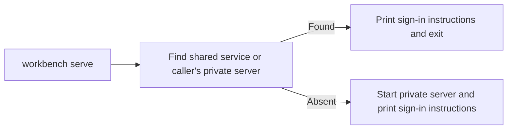
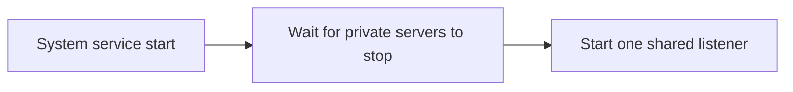

# TSK-3: Persistent service installation and lifecycle

## Review summary

Provide one optional installed service and a single browser listener for multiple OS users. The listener forwards each
authenticated request over a private OS channel to the worker running as that user. A narrow privileged supervisor
launches those workers. Each worker handles its user's projects, preferences, records, review state, and execution. Keep
browser rendering, document parsing, and project-selected code outside the privileged supervisor.

The CLI, server, and shared TypeScript core form one release. Ordinary CLI operations use the core directly;
coordinator-owned operations use its local API. The CLI remains usable without an installed or running server.
Collections remain independently selected. Reconcile the launcher's remaining project-specific executable selection with
this model. Workbench toolchain caches remain per user; use Nix and Guix stores through their existing managers.

### Browser access

Use browser-native HTTP authentication on loopback in both modes. After OS-authorized local communication,
`workbench serve` prints the server URL and a generated, revocable sign-in credential to the caller's terminal. The
developer opens the URL and enters the credential in the browser's built-in prompt. Core links and forms remain usable
without JavaScript. A new browser session can require sign-in again. Keep credentials out of URLs and retained logs.
Managed startup does not issue browser credentials.

Authenticate reads, actions, and event streams using the OS identity established at sign-in. Retain CSRF protection.
Qualify the browser-facing endpoint and credential isolation, including configured SSH forwarding.

The shared Linux service stores credential digests, account identities, and expiry in protected service state. It
verifies the account after a daemon restart or host reboot and revokes credentials when the browser origin changes or
the user signs out.

All private listeners and the shared macOS and Windows listeners keep browser credentials in memory. After the listener
restarts, run `workbench serve` for a fresh password. On Windows, this lets the CLI supply the current OS account's
identity even after a reboot or from an SSH session, without saving the user's Windows password.

A Chromium fixture exercised authenticated links, forms, and direct navigation with JavaScript disabled. A second
loopback port received no credential. Reopening the test browser required sign-in again.

### Configuration and process lifetime

Use common `[daemon]` runtime settings for installed services and private servers. Shared-service settings belong to its
administrator; private-server settings belong to the user. Project policy cannot override the shared daemon's authority
or limits.

| Setting                            | Proposed default     | Behavior                                                              |
| ---------------------------------- | -------------------- | --------------------------------------------------------------------- |
| System listener port               | Fixed protected port | Choose at installation and retain across restarts                     |
| Private starting port              | 8080                 | Try successive ports around unrelated listeners                       |
| User-worker idle timeout           | 60 minutes           | Start the timer when no clients or active work remain. Zero disables. |
| Persistent system session lifetime | 30 days              | Fixed expiry from sign-in, independent of worker lifetime             |

The managed listener stays running while idle. An unexpired session alone does not keep a worker alive. Recreate idle
workers on authorized demand, preserving durable state; ongoing checks, experiments, or admitted requests prevent idle
shutdown.

### Startup and handoff

Select the launch mode explicitly.

- `workbench serve` prints sign-in instructions for the shared service or the caller's existing private server and
  exits. If neither exists, start a private foreground server and print its sign-in instructions.
- `workbench serve --daemon`: the same selection, starting a persistent background private server only when needed.
- `workbench serve --service`: supervisor-managed execution, remaining in the foreground without issuing login
  credentials. Installed registration and OS permissions establish system or user authority; the flag grants none.

Commands never start a coordinator implicitly. If an operation requires a running service, explain how to install it
system-wide or in the user's profile, start an installed service, or run `workbench serve` explicitly. Ordinary CLI
operations retain their direct shared-core path. Another user's private server cannot substitute for the caller's server
or the shared service. Incompatible releases produce an actionable error.

Each user is served through either the shared listener or one private listener. System-service startup waits for private
servers to stop before taking ownership. Coordinate admission independently of HTTP port so these modes do not overlap.
Waiting is inspectable and cancellable; stopping a managed waiter leaves private servers running.

Retain loopback binding. Users arrange forwarding. The shared service keeps a fixed URL across Workbench process
restarts. Use an OS-protected port where available. On macOS, `launchd` owns the loopback socket while its registration
is loaded, including when the Workbench process is stopped. Shared macOS installation uses browser-native sign-in
without certificate setup. An occupied or unprotected system endpoint fails startup with an actionable error.

Private servers may probe for an available port. Use protected endpoint discovery in both modes, verify service identity
before issuing credentials, and print the selected localhost URL.

### Installation and updates

Target optional system and user installation on Linux, macOS, and Windows. Use systemd, launchd, and the Windows Service
Control Manager for system installation. Use native user startup facilities, with Task Scheduler for Windows login
startup where appropriate. Other supervisors can run foreground mode. Qualify endpoint protection, OS-user isolation,
and real installation on every platform. Bring any material platform limitation found during implementation back for
review before narrowing support.

Installation, updates, and removal preserve user data and active work. Verify replacements before activation, drain
managed work, check readiness, and restore the previous verified release on failure. Defer activation while a manual
server is active. Keep recovery outside the application payload; failure of that entry requires the external installer.
Uninstall removes registration without removing user data.

### Delivery checklist

- [x] Protect private browser access with native sign-in.
- [x] Coordinate shared and private startup, and route authenticated requests to isolated workers.
- [x] Install and manage Linux services with systemd and verify native lifecycle and identity boundaries.
- [ ] Install and manage macOS services with launchd and verify native lifecycle and identity boundaries.
- [ ] Install and manage Windows services with SCM and verify native lifecycle and identity boundaries.
- [ ] Verify coherent updates, rollback, repair, and removal across installed releases.

## Implementation account

### Private browser sign-in

The private listener challenges requests for project pages, events, and actions. It accepts a generated credential only
for the server process that issued it. Sign-in uses the OS username. The demonstration uses separate credentials for the
connection between the hub and its child. The hub fixes the child's network address at startup, keeping request paths
from redirecting requests or exposing that credential. Chromium exercised sign-in, form submission, and reload with
JavaScript disabled. The browser checks scope credentials to the service origin. Cache verification uses Chromium's
stored sign-in after the initial challenge, keeping its cache enabled. Retained service and fixture diagnostics redact
the generated password. An SSH tunnel to a different local port preserved the private listener's sign-in challenge and
authorized access.

### Private listener discovery

On Linux and macOS, an account-owned Unix socket returns the active server's sign-in to local CLI callers. An exclusive
lease covers startup, listening, and shutdown. The socket stays on the local filesystem so long or remote state paths
work. Its authority is independent of the browser port, and credentials stay in the listener's memory.

Explicit background startup runs the same release and waits for its private listening socket. The CLI exits after
printing sign-in and the listener's PID. A supervisor can run the private listener in the foreground with sign-in
available through a separate CLI invocation. Discovery returns the listener's URL even when it omits the default HTTP
port. A waiting supervisor can stop without affecting the existing listener.

### Shared Linux listener

The system service binds a port protected by the host and waits for private listeners before accepting browser traffic.
Local sign-in verifies the requesting account through its ownership of a one-use filesystem entry. The supervisor keeps
browser credential digests in protected state and forwards authenticated requests over Unix sockets to workers running
as their respective accounts. Browser sign-in uses the OS account. Idle workers can be recreated without renewing
browser sign-in.

An isolated Linux environment exercised both directions of private and shared startup, cancellation while waiting,
separate project visibility for two OS accounts, and sign-in across service restart. Signing out revoked only the
selected credential. An ordinary account could not claim the shared port while the service was stopped.

### Native lifecycle qualification

On Linux, transient systemd user and system units exercised the first privilege boundaries. An ordinary account could
not bind the system unit's protected loopback port before startup, during service, or after shutdown. Kernel Unix socket
peer credentials identified each of two callers independently of the request contents. Node workers launched under those
two identities with no effective capabilities and without the supervisor's supplementary group. Each could read its own
fixture file, and access to the other account's file was denied. The test removed its transient units and files.

A transient systemd user unit ran the Workbench private listener. A second CLI invocation discovered it and opened the
browser workflow. The journal contained no sign-in password, and stopping the unit released the listener's lease.

A verified archive registered a user service through the installed command. Repeating registration preserved an existing
definition with different settings. Native systemd started the test unit, the installed CLI obtained sign-in, and the
browser request succeeded. The test removed its own unit.

The system installer registered a verified release for native systemd. A temporary OS account signed in through the
installed CLI and retained its credentials across restart. The user service required fresh sign-in after restart. Both
installers preserved a modified registration. Removing the owned units preserved application files and durable state.
The native tests used isolated releases and accounts, and checked that sign-in stayed out of the journal. GitHub-hosted
Linux preparation runs both scopes against the built candidate.

Two ordinary accounts signed in through the installed system service. Each saw only its own registered project and could
still access it after its idle worker stopped. An open event stream kept its worker alive. Signing out left the other
account signed in. Starting a worker required the saved sign-in to match the current OS account. Changing its home
directory while idle caused the original sign-in to be refused.

### Installed release selection

Archive installation verifies the checksum and starts the candidate CLI before recording it as active. The CLI and
registered systemd service use the same launcher, which selects the stored release by its archive digest. The launcher
takes precedence over a consuming project's executable pin. Both native service tests used the archive installation and
the OS account for sign-in.

Archive updates verify the replacement and the retained rollback release. An active systemd service drains before the
launcher switches releases. The new service reports readiness after its browser and local sign-in listeners bind. If
startup fails, Workbench restores the previous selection and starts that release. An active manual listener defers the
switch. Native user and system units exercised an update, a failed replacement startup, an explicit rollback, and
manual-listener deferral.

Before stopping a managed service, Workbench saves its selected and replacement releases and the registered unit. The
stable launcher can run recovery from the previous verified release while the replacement is unconfirmed. Native user
and system tests killed the updater after the launcher switched and before the replacement became ready. Recovery
restored the previous selection and restarted the service. Repeating recovery left that service running.

The external installer restores a missing or damaged launcher from the verified archive and preserves damaged launcher
bytes before replacement. Native user and system tests repaired an unusable launcher with the selected service still
running. The service process and retained state were preserved.

## Implementing-agent detail

1. Qualify native lifecycle and identity boundaries first. Windows CI must exercise a real SCM host, authenticated CLI
   identity, and processes under two ordinary users, including their filesystem permissions and token/profile handling.
   Do not infer support from a scheduled task or mocked commands. Test logout/restart limitations without retaining
   users' login passwords. Bring material limitations back for review.
2. Implement machine ownership, protected discovery, browser sessions, worker spawning and idle cleanup, readiness, and
   shutdown. Drop supplementary privileges and establish each worker's identity before loading project inputs; never
   switch the shared process's identity or environment per concurrent request. Partition mutable state by user.
3. Add common daemon settings, explicit launch modes, and OS adapters. Preserve cancellable handoff without startup
   timeouts or restart loops. Select runtimes and environments explicitly, excluding temporary build-shell settings.
4. Reconcile installation, coherent updates, rollback, repair, and removal; update application decisions and guidance
   for authenticated multi-user access and qualify the delivered workflows for human acceptance.

### Acceptance and verification

- Exercise private-first, shared-first, simultaneous starts, owner crashes, stale discovery, duplicate registrations,
  and stopping a managed waiter. Repeated access commands produce sign-in instructions without duplicating listeners.
- Verify ownership of the fixed system endpoint against a competing ordinary user while the service runs and while its
  process is stopped. Exercise port conflicts, private port selection, bounded discovery, unavailable permissions, and
  unrelated listeners. On macOS, verify that `launchd` holds the port across process restarts and releases it when the
  registration is unloaded. Verify that managed removal discards credentials and that the browser only sends new
  credentials to the intended service.
- Exercise two users through one listener: distinct project lists, reads, edits, reviews, preferences, and OS execution
  permissions. Reject forged identities, cross-user access, and expired or revoked credentials.
- Verify that valid system credentials survive idle worker recreation. Check that the shared Linux service preserves
  sign-in after restart at the same protected browser origin. On macOS and Windows, check that a shared listener restart
  rejects the previous credential and `workbench serve` supplies a fresh password. Exercise a fresh browser session,
  bookmarks, reloads, forms, and downloads with JavaScript disabled. A new origin, a private server restart, or a
  revoked or expired credential requires fresh sign-in. Exercise credential isolation and SSH forwarding. Active work
  prevents idle termination. Use controlled clocks for time tests.
- CLI workflows remain usable without the service or a supported OS manager. Verify foreground, background, and managed
  modes, including manager stop/restart, output without credentials, and no nested backgrounding under a supervisor.
- CI on Linux, macOS, and Windows exercises real user and administrator installation, startup, status, logs, updates,
  rollback, shutdown, and removal. Use temporary OS identities and registrations, preserving the runner and developer's
  services. On a controlled Windows host, verify that SCM starts the system service after an OS reboot and Task
  Scheduler starts the user service after a fresh desktop sign-in. Observe both without issuing a manual start.
