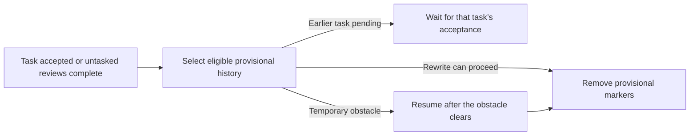

# TSK-5: Automatic finalization of reviewed commits

## Review summary

Accepting a task’s retained delivery triggers automatic finalization on its branch. The developer returns to Reviews
while Workbench removes provisional markers from eligible history. When an earlier task blocks already-accepted work,
accepting the blocking task releases both. For work outside a task, the last required review triggers finalization.

If a rebase, merge, cherry-pick, or revert is in progress, finalization stays pending until that Git operation ends. The
task stays accepted. Resume using that acceptance if the reviewed delivery still matches.

On a branch with commits A–D, if A and B meet every requirement and C is still pending, finalize through B. C and D stay
provisional even if D is ready. Their commit IDs change because their ancestry changes. The working files and staged
changes stay as they were. The original history remains recoverable. Publication is a separate action.

### History with merges

Each selected provisional commit must have all its provisional ancestors finalized or included in the same operation.
Independent sides of a merge can become ready separately. If a task spans both sides, wait until the selected history
includes the task's complete accepted delivery.

For example, a branch merges reviewed work A with pending work B. Finalize A if its task is complete and it is safe to
rewrite. Recreate the merge with the new A as the same ordered parent, the unchanged B as its other parent, and the same
file tree. Keep any pending merge provisional. Finalize the merge itself once both sides and the merge's own changes
have passed review. Show the merge result against its parents and identify resolution edits where possible. Bind merge
review to its final tree and every parent tree in order. First-parent review alone cannot establish this evidence. Reuse
the review when a rewrite changes parent commit IDs while preserving that tree context.

Keep unpublished local branches and tags aligned. When finalization replaces a commit reached by another local branch or
tag, update that reference in the same transaction. Recreate any affected descendants with identical trees and preserve
their provisional markers until their own review is complete. Move lightweight tags to the replacement commits and keep
annotated tag messages and dates. Workbench blocks pushing provisional commits. If any affected history or tag has
already reached a remote, defer automatic finalization.

## Implementation account

Agent change review records the merge result and each parent tree in order. It rejects a receipt from a first-parent
comparison or a changed merge context. A parent with the same tree can receive a new commit ID without losing that
review.

The terminal and browser show protected changes against all merge parents, including files that differ only from a later
parent. Human acknowledgments use that same ordered tree context and survive commit-ID changes.

Finalization selects reviewed ancestry while keeping task deliveries together. It recreates affected descendants with
the same source trees and keeps their pending markers. Removing a provisional marker preserves the rest of the commit
message. Finalization submits affected local branches and tags in one Git ref transaction. Recovery refs retain the old
tips and prepared replacements until explicitly removed.

CLI and browser decisions schedule finalization for the owning branch. The request survives server and CLI exits. An
active Git operation or an accepted outcome that still needs to enter Git history leaves the request pending for the
next handoff. The browser service observes Git operation markers and retries when an operation ends, including an
aborted merge that leaves the source tree untouched. Approval can return while finalization runs. A graceful server
shutdown drains the processes it started. Pre-push checks the exact outgoing object IDs selected by Git.

Background finalization writes unsigned replacements and retains signed originals for recovery. Manual finalization can
sign replacements through Git and uses the original key when renewing a signature. It can finish unsigned when signing
is unavailable. Pre-push still enforces the configured commit signature policy.

## Implementing-agent detail

1. Trigger finalization when the task’s retained delivery is accepted. If earlier work blocks already-accepted
   descendants, include them when the blocking task is accepted. Outside a task, trigger on the last required review.
   Reuse review and acceptance evidence while the commit tree, ordered parent trees, and accepted delivery match.
   Working-file acceptance applies after that delivery is retained. A Workbench handoff may resume an accepted rewrite
   after a temporary obstacle clears. Raw Git pre-push validates the object IDs Git already selected and can report how
   to finish preparing the branch.
2. Remove the provisional trailer and recreate only commits whose message or parents change. Preserve complete source
   trees, authorship, and parent order. Under the repository operation lock, verify that the prepared rewrite still
   matches current evidence and affected refs. Defer for active work, another Git operation, remote reachability, or
   signed work attributed to another author. Retain the old tips for recovery and conditionally update all affected refs
   together, preserving every linked checkout's index and working files. Keep manual preview, apply, and recovery.

### Verification

- A human acceptance returns promptly and triggers the update on an idle branch. Exercise the CLI with the server
  stopped. Accept a later task first and verify accepting the blocking predecessor releases both without another
  acceptance. Verify standalone reviews use their own trigger, and a deferred rewrite resumes after its obstacle clears.
- Exercise a partial prefix with a blocker followed by a ready commit. Cover a task spanning several commits, an
  unchanged approval after replacement, and an acceptance present only in working files. Confirm preserved commit trees,
  retained review evidence, provisional suffix, and stable index and working tree contents.
- Exercise a merge with one ready side, one pending side, and separate merge changes. Confirm the exact tree and parent
  order throughout, and verify that a task spanning both sides waits for its complete accepted delivery.
- Accept during a rebase or merge. Confirm finalization stays pending, then resumes after the Git operation when the
  reviewed delivery still matches. Also race a changed tip, active implementation, and interruption against a prepared
  rewrite. Move unpublished branches and lightweight and annotated tags together. Verify unsigned finalization of local
  signed work, retention of signed originals, and protection of foreign signatures, linked checkouts, and published
  references. If a ref changed, confirm that every other ref retains its old tip and recovery remains possible.
- Verify that ordinary Git pre-push validates its original outgoing object IDs and publication still requires separate
  authorization. Check the user-visible result when the branch cannot be finalized on that attempt.
