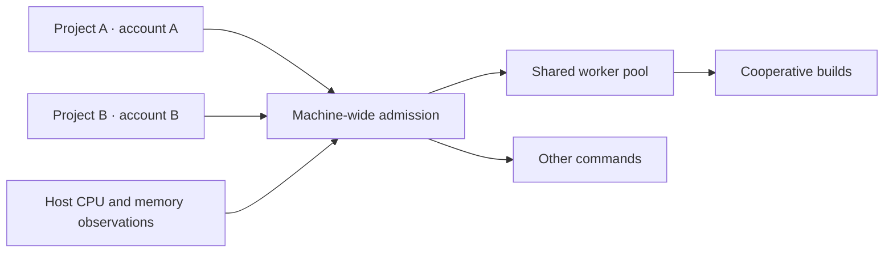

# TSK-8: Shared jobserver and adaptive work admission

## Review summary

The machine-wide jobserver runs in the installed Workbench system service. It owns one worker pool and one admission
queue shared by all projects and OS accounts. Rotate among projects with ready work and take jobs in arrival order
within each project. Each job runs under its caller's OS identity, using the protected local connection and process
ownership established by workbench-app:TSK-3.

Use available worker slots, recent host CPU use and contention, and available memory to decide when to start expensive
work. Give each new job time to ramp up. When CPU is saturated, the worker pool is full, or memory is under pressure,
delay new launches while running jobs continue. Compatible build tools draw worker slots from the pool. Other commands
take one admission permit and keep their own internal parallelism.

Ordinary checks can run with their existing per-invocation scheduling when the system service is unavailable. Report
standalone execution and keep service startup explicit. Existing free-space checks and pruning remain in effect.
Download reservations and disk-space admission can be planned separately.

## Delivery checklist

- [x] Share adaptive command admission across projects and accounts through the system service.
- [x] Add and verify native worker cooperation with the machine-wide pool.

## Implementing-agent detail

### Admission

- Default to one cooperative slot per available logical CPU and a separate active-job cap of that same size. The system
  administrator owns the machine limits. Caller settings such as `execution.max_jobs` and inherited CI allocations can
  lower an invocation's limits within the service's budget.
- Sample recent host CPU utilization and use CPU contention signals where the OS provides them. Allow a settling
  interval after launch and look for sustained recovery before resuming admission after saturation. Brief
  oversubscription is acceptable. With CPU observations unavailable, use the pool and job limits.
- Let the system administrator configure a minimum amount of available memory. Defer launches below that reserve or
  under OS-reported memory pressure. With memory observations unavailable, admit one expensive command at a time across
  the machine.
- Keep scheduling and lease accounting in the shared TypeScript core. Authenticate callers through the local API and
  keep execution, cancellation, and detailed job state scoped to the owning account. Preserve dependency ordering and
  setup ownership. Explain when capacity, CPU use, or memory is delaying a job.
- If the coordinator is lost mid-run, stop further admission and drain or cancel already-owned work. A normal standalone
  invocation uses the existing local scheduler.

### Worker cooperation

- Verify pinned GNU Make, Ninja, and Cargo/rustc builds with the GNU jobserver FIFO on Linux. Verify the same protocol
  on macOS before enabling it there. Start Windows at command granularity.
- Use a verified capability list for built-in runners. Enable native cooperation in custom or sandboxed environments
  after verifying access to the protocol. With CMake/Ninja on the shared pool, leave explicit parallel overrides unset
  so Ninja can join.
- Account for a cooperative command's implicit slot once. Qualify native access only where grants are scoped to the
  owning job and accounted for against the single machine pool. Use command admission when that boundary cannot be
  provided.
- On suspected token loss, stop new admissions to the affected pool and drain its participating processes before
  replacing it. Reclaim a command lease after its work has ended or responsibility for cleanup has transferred.

## Implementation account

The installed service admits native checks individually and managed environments as a session. Admission rotates among
projects and uses one shared job limit, CPU and memory observations, and the caller's existing execution limits. Checks
execute under the requesting account. Linux and macOS use protected local sockets, and Windows uses the authenticated
SCM channel and Windows Job Objects. Interrupted work keeps its lease until its processes exit. Ordinary checks use
local scheduling when the service is unavailable.

Compatible GNU Make, Ninja, CMake with Ninja, and Cargo builds on Linux and macOS share worker slots through job-owned
FIFOs. Each command keeps its implicit slot. The service lends and reclaims extra slots, gives waiting projects access
to idle slots, and pauses admission when token accounting needs recovery. Windows admits commands. Explicit parallel
settings and inherited jobservers keep their existing scheduling.

## Verification

- Run independent checks from different projects and OS accounts. Verify a common hard cap, project rotation, and
  isolated execution and cancellation. Exercise an invocation requesting a lower limit.
- Use controlled clocks and activity samples to cover full worker capacity, CPU saturation and contention, the
  configured memory reserve, OS-reported memory pressure, and missing observations. Verify that running jobs continue
  and waiting jobs start after recovery.
- Verify with pinned tools that independent builds share the worker budget, including across accounts wherever native
  sharing is enabled. Exercise cancellation, abrupt termination, and recovery without duplicated or stranded slots.
- Verify standalone invocation, coordinator loss mid-run, and service restart. Exercise representative builds on small
  and large hosts to choose and document default admission tuning and the memory reserve. Keep timing estimates out of
  test assertions.
