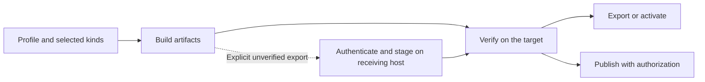

# TSK-9: Unified artifact profiles, transfer, and publication

## Review summary

Use one repository-owned profile catalog for artifact preparation and delivery. A profile selects exact projects or
subprojects, an environment, and supported target, kind, and format combinations. Build development and release outputs
from the same profile with `workbench artifact build native --kind development --kind release`.

The toolchain artifact contains verified tools and their libraries. CI restores locked project dependencies separately,
so a dependency update can reuse the toolchain. The development artifact adds all locked inputs needed to build and
check a separate checkout offline. The release artifact contains the runnable application, assets, and its declared
runtime requirements.

Export files to a directory, deliver OCI images to a configured registry, or publish an official release. A recipient
can restore a development artifact on a compatible offline machine. If verification needs a different host, explicitly
export an unverified candidate for that host to authenticate, stage, and verify before activation or publication.

A recipient can install native toolchains offline from a Linux tarball or a macOS or Windows ZIP. Workbench checks the
archive against the expected SHA-256 supplied by the recipient before extracting it. The embedded installation manifest
describes the files to check before activation.

The interactive `workbench artifact` command offers to run or manage profiles. Running a profile shows the included
projects, then offers compatible choices based on the profile and earlier selections. Show a choice even when there is
one option. A custom selection starts with the host target and can be saved for reuse.

| Choice      | Typical values                                          | What determines the available choices       |
| ----------- | ------------------------------------------------------- | ------------------------------------------- |
| Kind        | Toolchain, development, release                         | Profile and project recipe                  |
| Target      | Linux x64, Linux ARM64, macOS ARM64, Windows x64        | Kind, supported targets, and available host |
| Format      | Archive, OCI image, Nix or Guix export                  | Kind, target, and packaging support         |
| Destination | Local directory, OCI registry, GitHub or GitLab release | Format and configured publication policy    |

For example, a Linux development OCI image can be delivered to a registry. A Windows release archive can be exported as
a ZIP or attached to a configured hosted release. The `archive` choice resolves to `.tar.gz` on Linux and ZIP on macOS
and Windows.

CI covers distinct build variants by default, shares equivalent source checks, and verifies each packaged format.
Publication is manual by default. A project can independently enable publication on branch pushes or version tags.
`artifact publish` delivers selected verified outputs. `release publish` delivers an official tagged release through the
same publisher and records the artifacts actually published in REL.

## Delivery checklist

- [x] Separate reusable toolchains from project dependency inputs. Qualify offline development restore for native, Nix,
      and Guix.
- [x] Unify the profile catalog and artifact CLI. Build, verify, export, and import supported artifacts, including
      transferring candidates that need verification on another host.
- [x] Migrate the existing profiles and example scopes. Use the shared catalog for local and hosted CI and verify the
      toolchain images before switching CI to them.
- [x] Use one publisher for artifact delivery and official releases. Support the configured triggers and write REL
      records from the published outputs.
- [x] Embed an installation manifest in native toolchain archives and verify the whole archive before extraction.
      Qualify offline ZIP import, relocation, and tool activation on macOS and Windows with an empty cache.

## Implementation account

The project catalog defines artifact choices and keeps workspace and packaging recipes in the same file. The terminal
workflow can save a custom selection from the catalog and choose output kinds at build time. Native, Nix, and Guix
distinguish toolchain preparation from the locked inputs used for a development build. Registered example scopes
identify ownership without changing their language check roots.

Artifact listing reports current and outdated outputs and their build prerequisites. The agreed size view uses the byte
counts and observation time from the inventory that checks which outputs exist. This supersedes the planned size cache
and refresh option. Registry lookup is explicit and distinguishes missing images from lookup failures. A matching local
image can be qualified for another checkout without rebuilding it. File inventory shares source and verifier
observations across formats. Follow-up commands select a unique current artifact, including a verified import. If
several equally verified outputs contain different bytes, select a generation explicitly.

A build batch can export its outputs or publish them after every selected build succeeds. Verified outputs remain
available if delivery fails. Retrying an export reuses matching bytes and verification. An interrupted batch preserves
completed outputs and reports which selections did not start.

Verified local builds can retire superseded generations under the cache retention settings. Active generations, exports,
and imported target evidence remain available.

The example release recipes use the shared catalog and their owning project scopes. Directory-shaped releases are packed
as Linux tarballs or ZIPs for macOS and Windows. POSIX archives preserve executable modes and contained links. Existing
single-file packagers retain their output bytes. Native CI and local rehearsal check a fresh extraction of the retained
archive. The native Linux x64 Go rehearsal passed this check. The artifact workflow also built, verified, and exported
native Go and Java releases, Nix Go closure and portable archives, and Guix Go portable, relocatable, and Docker
packages. The single Go Guix SquashFS output ran offline through Apptainer outside the source and builder stores.
Workbench's release recipes reuse the same-run portable candidate archive on Linux and repackage its verified files as
ZIPs on macOS and Windows. The verifier starts the extracted executable outside the source checkout.

CI checks its selected image recipes and platforms against the artifact catalog. The same selection feeds local
rehearsal, hosted jobs, and the pre-push registry check. The separate preparation workflow can build and verify
toolchain-only images through the catalog before the check gate switches to those images. CI restores locked inputs for
the selected roots and toolchains once per operation. The offline and online check partitions use the same acquisition.
Toolchain image qualification uses the ordinary tool and compiler probes without starting project dependency setup.
Local and hosted prepared-image jobs share the runner. Rehearsals of both entry points on native Linux x64 acquired Go
dependencies once per operation and passed five offline checks and the online advisory check. The Nix Linux x64 image
passed tool and compiler qualification and all four configured Go checks offline. Each rehearsal preserved the lockfile.
All six Linux toolchain images passed offline qualification and were published with verified registry digests. The ARM64
images ran through binfmt on Linux x64. CI selects these toolchain profiles, and a Guix x64 Go rehearsal passed with
separately restored project dependencies. Local rehearsal, the reference workflow, and generated GitHub and GitLab
pipelines plan release package checks from the catalog. Equivalent recipes share work. Distinct formats and targets
retain separate verification, and explicit exclusions retain their reason. The reference workflow groups related formats
by owner, target, and builder.

The general artifact export carries transfer metadata binding the recipe, inputs, payload digest, and verification. The
receiving host authenticates that metadata against a supplied checksum and verifies the payload in private storage. The
receiver can select the retained generation for publication without rebuilding the file. Release builds bind to a Git
revision only from a clean checkout. The publication commands share byte verification and use hosted release results to
produce release records. File recipes can declare verifier inputs separately so an updated verifier can check retained
bytes. One release can combine distinct profile builds for the same target and format, as well as generations from
different targets. The publisher authenticates target verification against the same tagged source. Hosted CI checks the
source and packages on the selected native runners. Tagged delivery reuses matching checks and verifies separate bytes
when a recipe uses the tag. One publishing job assembles the complete delivery from the target exports. Workbench's
release workflow publishes the exact portable tarball and native ZIPs from the selected Checks run. It creates a project
release record from the verified remote downloads and retains it with the workflow run. Branch publication reuses
matching prepared images and retains the source revision and verified registry digests with the run, including
deliveries completed before a later failure. Branch delivery prepares and exports images separately from publishing. The
explicit image preparation workflow uses the same separation, with independent preparation and delivery for each image.
The publishing job authenticates the transferred bytes before registry sign-in. GitLab uses an environment-scoped
credential for a destination outside the source project's job-token authority. OCI delivery resolves the published
digest at the registry. A retried delivery reuses the same image under an input-derived tag and rejects a tag pointing
to different bytes.

OCI archives carry one immutable image and no registry tags. Workbench authenticates the archive before loading it and
qualifies it offline on the receiving host. An assembled candidate has its own tag until verification succeeds, so a
failed replacement preserves the accepted image. Qualification reads inherited Dev Container settings from the
transferred image.

Managed preparation can export the realized profiles and their store dependencies without assembling an image. Guix
restore verifies archive signatures against the recipient's authorized keys before introducing objects into the store.
Archive recipes reuse the selected preparation profile. Receiving inputs must match the export, and the verifier
receives the authenticated archive and a fresh checkout. The built-in verifier uses a pinned bootstrap in a disposable
container. It restores and pins the profiles, then runs the selected checks as an unprivileged user with fresh caches
and no network access.

Native Linux archives carry original tool downloads and authentication data from a private acquisition cache.
Development archives can also carry package caches. Import restores the inputs at new paths, reruns the normal tool
installer with networking disabled, and verifies the selected project. The Java toolchain transfer installed the signed
JDK in a fresh cache. The development transfer also restored the Maven dependencies and passed the Java example's setup,
build, and smoke checks in a separate checkout.

A native archive can back a regular development shell. Workbench seeds a cache for the selected verified generation and
installs the tools at their final host paths. The Java example ran the build and smoke checks from the imported archive
on the receiving host.

Native tarballs and ZIPs carry an installation manifest that binds the target and profile to the retained downloads and
upstream proof files. A recipient can import the archive directly by its trusted SHA-256. Workbench checks the archive
before extraction and the payload before running the normal offline installer. The qualification built and exported a
pinned Go toolchain, imported it into a fresh cache, and ran it there on Linux, macOS, and Windows. Native CI repeats
the ZIP qualification on macOS and Windows.

Nix and Guix exports can back the same shell command. The isolated store is restored under the pinned bootstrap with
networking disabled. Linux x64 rehearsals ran Go from a Nix export and Node.js from a signed Guix export. Both used
linked worktrees, resolved their Git metadata, and wrote files with the host user's ownership.

## Implementing-agent detail

### Profiles and CLI

- Put profiles and their workspace defaults in `workbench/profiles.toml`. Each named profile has one tool authority
  (native, Nix, or Guix), exact registered project IDs, and explicit supported combinations of target, kind, and format.
  Targets declare OS, architecture, ABI, CPU baseline, and minimum runtime where applicable. A parent scope yields its
  own product. An explicit project recipe can assemble a combined product.
- Give each product/environment/variant one packaging recipe reusable across formats. The recipe declares relevant
  inputs, literal build and verify argument arrays, an isolated output directory, and supported packaging capabilities.
  Keep package graphs with their builders. Preserve independent compiler/runtime profiles and their `--toolchain NAME`
  selector. Resolve language roots from scope ownership and declared inputs.
- Validate the catalog and recipe references strictly. Preserve comments on edits and resolve policy from the selected
  Git snapshot for hooks and CI. Listing and planning distinguish valid profiles with missing prerequisites from invalid
  declarations. Existing profiles keep their saved target choices. Initial selection offers configured managers.
- `artifact list` shows profiles, available choices, readiness, and whether existing outputs are out of date.
  `artifact add`, `edit`, and `remove` preview changes to the catalog and show affected references. Profile removal
  leaves retained outputs available under the storage policy below.
- `artifact build PROFILE... --kind KIND` accepts repeated `--kind` for `toolchain`, `development`, or `release`.
  `--all` selects all profiles. `--target`, `--format`, and an alternate profiles file support explicit automation.
  `build --plan` inspects without acquiring tools or starting builds. `--json` controls serialization. Scripts with a
  missing selection receive an actionable error. Help, completion, and inspection work without project registration or a
  prepared manager.
- Resolve the full selection before starting. Reject an undeclared or unavailable combination and identify the supported
  host or missing prerequisite when applicable. For execution failures, identify which outputs succeeded, failed, or did
  not start so a retry can reuse completed work.
- `artifact inspect` and `verify` expose realized inputs, requirements, verification, and ownership. `artifact export`,
  `import`, and `publish` use identified outputs. Build can compose export or delivery in the same invocation. Delivery
  failures preserve successful builds. List cached sizes with measurement time and an explicit refresh. Query a registry
  on request and keep confirmed absence distinct from a failed lookup.
- Daily commands such as `development use`, `shell`, and `check` read the shared catalog. Migrate owned callers before
  removing superseded preparation subcommands. The CLI uses the existing TypeScript services and works without a daemon
  or jobserver.

### Identity, formats, and transfer

- Keep recipe, realized bytes, and verification identities separate. Hash resolved content inputs. Toolchain identity
  covers tool pins, tool requirements, OS/ABI, and content-producing definitions. Development adds selected dependency
  inputs. Release adds source, packaging, runtime assumptions, build flags, optimization inputs, and relevant version
  data. Project lockfile tools are dependencies even when used for checks. Rebuild project outputs from source.
- Reuse compatible tool layers, dependency downloads, and verified payloads. A native OS refresh can produce different
  bytes from the same logical recipe. Record actual package versions and immutable digests. Destination, scheduling, or
  verifier changes by themselves affect delivery or evidence. Source changes require fresh offline qualification where
  relevant, while dependency payloads remain reusable if their inputs match.
- Resolve `archive` from the target OS even when the builder uses a different OS. Preserve OCI and Apptainer through the
  respective Linux environments and keep archive exports as files. Preserve executable modes, supported links, bundle
  structure, and applicable signing material. Use maintained streaming archive tools with ZIP64 support and
  receiving-platform extraction tests.
- Offer optional Linux SquashFS and macOS DMG only for qualified combinations. Restore through extraction or native
  copying into owned storage. Leave manual mounting and unmounting to existing tools, including direct read-only access
  to a SquashFS image. Windows disk-image formats are deferred.
  [Linux kernel SquashFS documentation](https://docs.kernel.org/filesystems/squashfs.html)
- Use managed Nix and Guix definitions to expose toolchain and project dependency inputs separately. Prove that each can
  be realized without an application build. Export the required store closure and manager inputs using native
  mechanisms. Restore the selected authority and pin profiles durably against garbage collection. Managed store import
  and relocatable application packs have separate restore strategies.
- Put a versioned installation manifest inside each native toolchain archive. Record the target, prerequisites, upstream
  provenance, and the paths, sizes, SHA-256 hashes, modes, and link targets of the other entries. The recipient supplies
  the archive path and a SHA-256 obtained through a trusted channel. Check the complete archive before extraction, then
  verify the extracted entries and compatibility in private staging before activating the toolchain.
- Retain transfer metadata linking exported bytes to their recipe and verification. Stage imports privately and publish
  local ownership atomically. Repeated imports of verified bytes are idempotent.
- Allow explicit export before target verification and mark the output and its transfer metadata as unverified. The
  receiving host authenticates the artifact and stages it privately for qualification. Keep it in staging until
  verification on the target succeeds. Activation and publication require target verification for those bytes.
- Restore native SDKs from verified distributions or supported offline installers where needed. Prove relocation to
  different home, project, and cache paths before advertising it. Record external system prerequisites and allowed
  redistribution. Use a supported offline installer layout for Visual Studio and identify any required administrator
  action. Include the required Workbench release and Node runtime or declare them as prerequisites.
- For explicit foreign Linux execution, require approved binfmt and qualify x64 on ARM64 and ARM64 on x64 where suitable
  hosts are available. Record native, emulated, and cross-built provenance. Promised native support still requires
  native execution evidence. Keep the existing required platform and compatibility matrix.

### CI and publication

- Use the same resolved catalog for preparation, local rehearsal, hosted CI, and required-image checks. Routine CI pulls
  toolchain artifacts or uses allowed verified host tools, then restores locked project dependencies. The
  destination-specific pre-push gate checks required images and reports missing artifacts separately from a failed
  lookup. Keep image preparation and publication explicit.
- Cover each profile's distinct build variants by default. Require a reason for an explicit exclusion and preserve all
  required native and compatibility coverage. Run equivalent source checks once across formats and profiles. Retain
  actual compiler, ABI, optimization, and platform differences. Verify each packaged format separately. Toolchain probes
  check tool and ABI usability. Development verification exercises a clean checkout using the prepared artifact. Release
  verification runs outside the source checkout. The configured CI gate supplies full test and coverage evidence.
- Match reused verification to artifact digest, recipe, relevant source and lock snapshot, target, execution mode,
  verifier inputs, and freshness policy. A changed verifier can requalify retained bytes. A newly tagged version may
  reuse matching CI evidence. Include the version in the recipe when it changes the built bytes.
- Offer Manual, On branch push, and On version tag. Keep both automatic triggers off by default and let a project enable
  them independently for configured branches, tags, and destinations. Each trigger starts a separate publication
  workflow subject to project authorization and evidence requirements. Use committed source and complete local or hosted
  verification as permitted by project policy. Branch snapshots retain artifact manifests and channel history. A version
  tag can reuse matching CI evidence. If the tagged version changes the artifact bytes, verify the resulting artifact
  before publication.
- Keep destinations, triggers, and accepted verification sources in a separate policy section of the profiles file.
  `artifact publish` sends chosen verified outputs to their destinations. `release publish` checks the official version
  tag, including annotated and lightweight tags, uses the same publisher, and records the actual published artifacts in
  REL. Target GitHub and GitLab for hosted software releases. Generic OCI delivery is independent of the Git host.
- Restrict publication credentials to authorized delivery steps after evidence checks. Verify remote bytes, retry
  transient failures, and resume partial delivery without rebuilding. Treat a version with different existing bytes as a
  conflict. Serialize channel updates and retain the publication result so REL creation can retry separately.

### Retention and migration

- Store regenerable artifacts as immutable cache generations with ownership and provenance. Leave OCI data in the
  container engine and managed objects in their authoritative stores. Protect active/shared assets, durable manager
  roots, and explicit filesystem exports. Prune owned superseded generations after verified replacement using the
  configured retention policy and fresh ownership analysis. Registry deletion is a separate explicit operation.
- Reuse disk-space protection and locks across staging, verification, delivery, and pruning. On cancellation or
  interrupted import, clean up owned staging and preserve completed outputs and the previous usable generation. Report
  the affected profile, target, and operation with a useful cause and recovery action.
- Migrate current development/release configuration, product recipes, CI image bindings, and documentation together.
  When migrating recipes for independently runnable language and React examples, register each as a subproject and give
  it ownership of its packaging recipe. Use the supplied charter sentence `Example {language} application.` including
  `Example React application.` Retain required example checks under the new scopes.
- Move CI to prepared toolchain-only bytes after availability is verified. Retain the last usable outputs under the
  applicable data policy and verify any reused identity. Existing development evidence applies to the full development
  contents.
- Review policy changes to workbench:ADR-S, workbench:ADR-Y, and workbench:ADR-X for the unified profile, split CI
  inputs, and separate authorized publication. Review workbench-app:ADR-1 and workbench-app:ADR-2 if inspection requires
  a change to project registration policy. Keep schema and command examples in the guides.

## Verification

- For development OCI images, mount a fresh checkout into the image and run the declared build and offline checks.
  Exercise a runnable output where applicable. For archives and manager exports, restore the artifact on a compatible
  host and repeat the same build and checks with fresh source. Disable networking, start with empty host dependency
  caches, and use a fresh build output location. Include relocated source, home, and cache paths, a native SDK with
  runtime libraries, and restored Nix and Guix profiles pinned against garbage collection.
- Exercise multi-kind builds from one profile, `--toolchain`, single-choice prompts, unsupported combinations,
  independent subprojects, and deterministic planning. Verify portable formats on their supported targets. Qualify
  optional formats before listing them. Transfer an unverified candidate and confirm the receiving host blocks
  activation and publication until it authenticates, stages, and verifies the artifact.
- Show that equivalent source checks run once, distinct variants keep their required coverage, and each format is
  verified. Exercise CI with a qualified toolchain image and separately restored locked dependencies. Run release
  artifacts on the promised targets outside the source checkout.
- Test manual publication and each automatic trigger independently, including when a version tag changes the bytes.
  Check that `artifact publish` delivers verified outputs and `release publish` records the actual artifacts in REL.
  Exercise remote conflicts, retries, interrupted record creation, cancellation, and concurrent import and pruning.

Maintain these contracts with consumer and platform checks. Keep the full configured gates and approval requirements.
