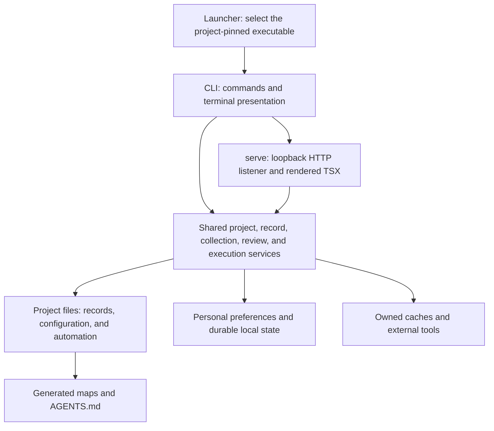
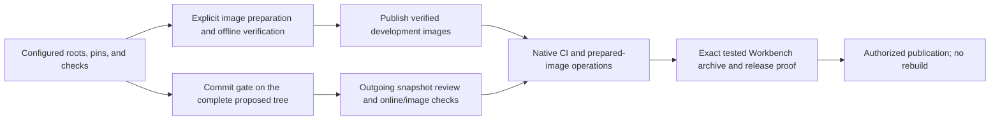

# Workbench architecture

[Workbench overview](../README.md). This guide explains the current system; the [source map](../workbench/source-map.md)
supplies implementation entry points.

Workbench is a TypeScript application distributed as prebuilt JavaScript for Node.js. One executable provides the CLI
and the foreground local web service. Neither interface requires another language runtime, a browser engine, or a
TypeScript compiler. Language SDKs and browser automation belong to development and consuming-project checks.

## Components and authority

Shared services own validation and mutations. The CLI and browser call those services rather than treating either
interface as a second authority. The web listener renders Preact TSX and supplies small browser controllers for live
updates and interaction; authored CSS is embedded with those assets. Read-only acquisition and expensive maintenance use
owned workers so they do not block the HTTP listener. A listener keeps one worker-code generation until shutdown. The
read worker prepares document content, review baselines, and formatting from one captured workspace view. Concurrent
readers share reconciliation; publishing a complete replacement preserves the exact versions already presented for
review.

A **project** is a registered consuming checkout. Its **subprojects** own narrower record scopes, with optional display
names and independent human-written charters. A **language root** selects a check boundary and need not be a subproject.
A **collection** supplies independently versioned decisions: adopted project copies are editable, while local
installations remain separate policy sources. The consuming charter governs adopted adaptations. See
[adoption](adoption.md#projects-and-subprojects) and [collections](collections.md).

## Stored information

| Information                                                  | Location and authority                                                   | Cleanup behavior                                              |
| ------------------------------------------------------------ | ------------------------------------------------------------------------ | ------------------------------------------------------------- |
| Charters, records, configuration, automation                 | Project-owned files, normally committed                                  | Preserved by cache cleanup                                    |
| Maps and project `AGENTS.md`                                 | Committed outputs derived from records                                   | Regenerated by `sync`; verified by validation                 |
| Adopted collection originals                                 | Git objects selected by configuration and gitlinks                       | Fetched explicitly when comparison needs missing objects      |
| Human file acknowledgments and agent review receipts         | Git-local `workbench/review.json` and `workbench/agent-reviews.json`     | Local evidence, independent for linked worktrees              |
| Task execution queue and project registry                    | User state directory, keyed by checkout                                  | Persistent across server restarts and cache cleanup           |
| Personal preferences, feedback, local policy                 | Platform configuration/data/state directories                            | Independent of disposable caches                              |
| Builds, dependencies, tool downloads, check results and logs | Owned cache namespaces and selected storage roots                        | Reviewed pruning and configured retention protect active work |
| Prepared image bytes and builder stores                      | Docker; Workbench retains ownership and verification metadata separately | Local retention is separate from explicit registry deletion   |

The [storage guide](tooling.md#build-and-dependency-storage) describes platform locations, overrides, ownership, locks,
and retention. Cached size measurements are estimates, never permission to delete. An operation revalidates ownership
and active use before removing resources. Records and experiment evidence are not regenerable build caches.

## Review and planning

Human record review acknowledges the contents actually presented, independently of staging. The terminal captures those
contents; the server retains immutable browser presentations, and confirmation submits their version digests. If the
file changes meanwhile, the displayed version can still be acknowledged and newer edits remain pending. The commit gate
requires the committed contents to match an acknowledgment. See
[record review](checks.md#review-receipts-and-coverage-evidence).

Agent change review binds the complete proposed project snapshot and baseline before commit. Accumulated task review
binds the publication batch. These receipts record assessments and do not authenticate the reviewer or replace human
decisions. Task files retain shared planning and acceptance; the local queue retains execution order and progress.
Policy compatibility is a separate agent assessment, with concrete conflicts routed to human resolution through the same
browser review queue. See [agent review evidence](records.md#agent-review-evidence) and
[local compatibility](collections.md#local-context-and-compatibility).

## Checks, images, and releases

Check groups run in dependency order with bounded admission. Native execution selects pinned tools and a constructed
environment; Nix and Guix retain their own tool authority. Successful local gates can be reused only when their inputs
match; online advisory checks remain fresh. Cancellation drains owned children before releasing locks and scratch.
[Checks](checks.md), [execution resources](execution.md), and [CI](ci.md) describe those boundaries.

Development images contain tools and locked dependency inputs, not successful application build outputs. Their identity
depends on declared content inputs and target architecture. Source-specific offline verification is separate evidence.
Explicit binfmt execution may verify and publish a foreign development image; native CI is still required for promised
platform support before the Workbench release. The release archive contains portable JavaScript and requires Node; Linux
development images are separate internal artifacts. See [profiles](profiles.md#prepared-development-images).

## Trust and operations

The web service binds to loopback and acts with the invoking user's filesystem permissions. It protects browser origins
and mutations but provides no shared-user authentication. The demonstration runs in isolated temporary storage. Project
commands and acquired tools execute code; verified inputs and controlled environments are not a general sandbox.
Acquisition verifies declared hashes and available upstream proofs before activation, with credentials supplied outside
tracked files. [Web operation](web.md) covers refreshing, shutdown, request diagnostics and accessibility; the
[tooling guide](tooling.md#diagnostics) covers retained logs, inspection and recovery.

Installed executable updates, collection reconciliation, and development dependency/toolchain maintenance have separate
authorities and commands. See [installation](installations.md), [collections](collections.md), and
[maintainer updates](contributing.md#repository-maintenance) before changing those selections.
