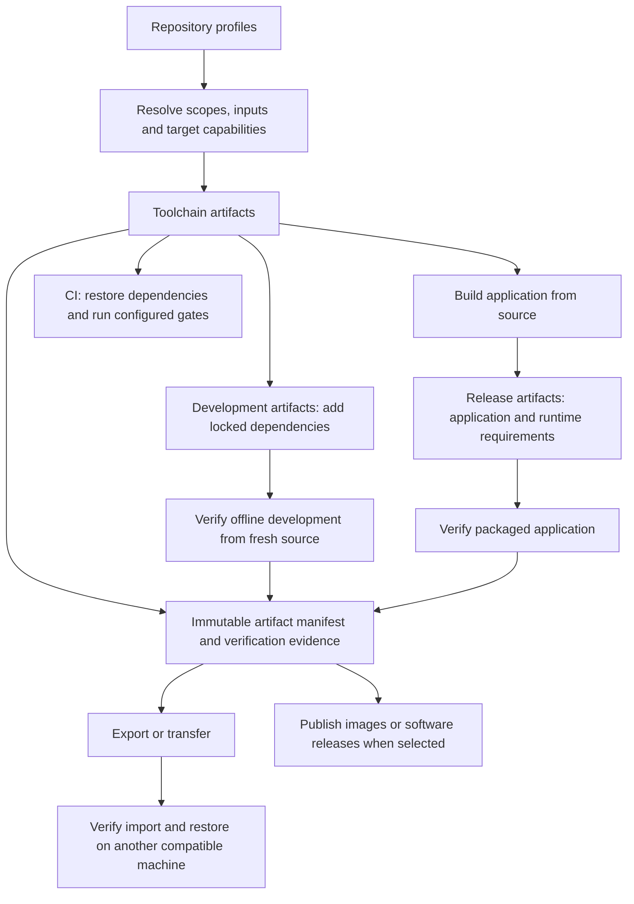

# Artifact workflows proposal

Status: proposed for human review; implementation is on hold. This proposal consolidates the artifact discussion and a
review of the current implementation. Confirmed choices are identified below; the remaining design is recommended for
approval. It does not authorize implementation or publication. The developer has selected TSK-0 for the parent planning
record; migrate this proposal into that record and its supporting files without retaining a duplicate account here.

## Human overview

Workbench should offer one artifact workflow for retaining and transferring toolchains, preparing offline development,
and distributing applications. Today, development images, release profiles, language packaging commands, and Workbench's
own release archive have separate interfaces. Their capabilities differ even where the underlying builders could do the
same work. Project dependencies also invalidate the images that ordinary CI consumes.

Use named **profiles** in `workbench/profiles.toml`, accessed through **`workbench artifact`**. A profile selects
project scopes, an environment, and supported target and format combinations. At execution time, choose **toolchain**,
**development**, **release**, or several of these. Profiles can configure all three without duplicating their shared
settings. CI consumes toolchain artifacts and acquires project dependencies separately. Development artifacts add the
locked dependencies needed for offline work. Release artifacts contain the application and its runtime requirements.

Building and delivering are separate operations sharing the same implementation. A user can build once, export files,
push an image, transfer it offline, or publish an official release after verification. Exporting or publishing existing
verified bytes does not rebuild them. Hosted CI is one source of verification and one place to publish, not the only
permitted publication environment.



The graph describes shared inputs, not a requirement to export a toolchain archive before building an application. Local
development continues to use installed tools and caches. Packaging occurs when an artifact is requested.

### Confirmed choices

| Question                                                  | Agreed direction and reason                                                                                                         |
| --------------------------------------------------------- | ----------------------------------------------------------------------------------------------------------------------------------- |
| One workflow or separate development and release presets? | One profile can produce multiple artifact kinds. Select kinds at runtime; avoid duplicate profiles.                                 |
| Where do profiles live?                                   | A dedicated repository configuration file, proposed as `workbench/profiles.toml`.                                                   |
| What does CI consume?                                     | Toolchains without project dependencies. Retain dependency caching in the CI workflow.                                              |
| What does offline development include?                    | Toolchains plus locked project dependencies; preserve the environment's tool authority.                                             |
| How are scopes selected?                                  | Project and subproject IDs, without public language-root filters. Independently deliverable subprojects can be released separately. |
| Are all formats containers?                               | No. Images use registries or image archives; ordinary files use filesystem exports. Do not wrap tarballs in OCI images.             |
| What are the platform defaults?                           | Compressed tar on Linux; ZIP on macOS and Windows. DMG is optional on macOS; SquashFS is optional on Linux.                         |
| What about Windows disk images?                           | Indefinitely defer ISO, VHD/VHDX, WIM, and similar Windows disk-image formats.                                                      |
| What about foreign Linux architectures?                   | Explicit binfmt execution in both directions between x64 and ARM64. Retain native evidence for promised native support.             |
| Must releases be published by CI?                         | No. Share profiles and verification between local and hosted publication, subject to project policy. Official releases are tagged.  |
| What may example charters say?                            | The human-supplied sentence `Example {language} application.` including the period.                                                 |
| When may implementation begin?                            | After review and approval of the concrete plan. Do not resume the project split or stopped Guix ARM64 work as part of planning.     |

### Recommendations needing approval with the plan

1. Use `--kind toolchain`, `--kind development`, and `--kind release`, repeatable, rather than a Boolean `--toolchain`.
   Existing commands use `--toolchain NAME` for compiler/runtime compatibility selections; avoid giving it a second
   meaning.
2. Keep profiles explicit about supported target/format combinations. Do not generate a Cartesian product or silently
   omit unavailable targets. Resolve the portable `archive` choice to `.tar.gz` on Linux and `.zip` on macOS/Windows.
   Offer other tar compression explicitly where the receiving environment supports it.
3. Start native SquashFS and DMG import with extraction or platform-native copying into owned storage. Do not add an
   automatic mount manager in this change. Preserve existing Apptainer use, and document manual read-only mounting.
4. Enable CI coverage for every profile by default, with explicit exclusions and reasons. Preserve independent required
   platform and compatibility coverage; profiles cannot reduce it implicitly.
5. Make automatic software publication opt-in. Offer independent **Continuous snapshots** and **Tagged releases**
   policies, plus explicit manual publication. Retain Workbench's existing manual publication until deliberately
   changed.
6. Register the independently runnable language and React examples as subprojects when migrating their artifact recipes.
   This gives each a packaging owner and the supplied charter; it does not make language roots subprojects in general.

### Review conclusion

The design is coherent with these boundaries. Its largest implementation risks are partitioning managed toolchains from
project dependencies and restoring native SDKs at a different location. These require early executable proofs before the
old interfaces are removed. A design review cannot establish that those proofs pass. The phases below make failure
visible before a broad migration, without falling back to dependency-filled CI images or unsupported SDK copying.

## Implementing-agent detail

### Task history and scope migration

Preserve the plan, material recommendations and decisions, and eventual completion evidence in the task records under
[ADR-7](../workbench/decisions/ADR-07.md). Distinguish agent implementation choices from human direction; include
chronological or contributor context when useful. At completion, describe actual delivered behavior and explain material
departures from the plan; do not leave the record describing only future work. Detailed contribution guidance belongs in
the [records guide](records.md), without assigning one agent to a task spanning multiple contributors.

Create coherent child tasks for independent outcomes and evidence, keeping detailed steps within their owning child.
Nested subproject scopes are already supported. Canonical references use the owner's registered project ID; displayed
name breadcrumbs show its ancestors. During the project split, place implementation tasks in the implementation scope
and collection tasks in the collection scope, updating scoped references and maps. Preserve record numbers where
available and retain the old-to-new identity correspondence. A committed-record migration needs the human-approved
exception proposed in ADR-4 and migration-aware gate support; the current gate rejects all removed primary records.

### Vocabulary and ownership

| Concept           | Meaning                                                                                                                            |
| ----------------- | ---------------------------------------------------------------------------------------------------------------------------------- |
| Profile           | Repository-owned reusable artifact settings; one environment and explicit target/output combinations.                              |
| Kind              | Contents: `toolchain`, `development`, or `release`.                                                                                |
| Environment       | Tool authority: `native`, `nix`, or `guix`.                                                                                        |
| Target            | Operating system, architecture, ABI, CPU baseline, and declared minimum runtime/system requirements.                               |
| Format            | Representation such as archive, OCI image, native store export, SquashFS, or DMG.                                                  |
| Recipe identity   | Resolved inputs that determine artifact contents, independent of its name or destination.                                          |
| Artifact identity | Digest of the realized bytes or OCI manifest; separate from recipe identity.                                                       |
| Verification      | Evidence for a particular artifact, target, claimed behavior, and verifier definition.                                             |
| Publication       | Delivery of verified immutable bytes to a configured destination; an official release also has a version tag and release metadata. |

Use a shared TypeScript core with CLI adapters and existing execution, acquisition, verification, ownership, and storage
services. Neither the future daemon nor jobserver is a prerequisite. The CLI must remain fully functional without them.
Do not build a second generic workflow engine, dependency resolver, archive implementation, or container registry
client.

### Profile configuration

`workbench/profiles.toml` owns artifact profiles and their development-workspace defaults. Each profile has a stable
name, one environment, explicit project IDs, and one or more target entries. Each target lists the formats available for
each kind. An absent kind is unsupported for that target. This models actual combinations without duplicating an entire
profile for development versus release, or assuming every builder implements every format.

Illustrative proposed schema:

```toml
schema_version = 1

[[profile]]
name = "native"
environment = "native"
projects = ["workbench"]
workspace = "host"
container_config = ".devcontainer/devcontainer.json"
ci = true

[[profile.target]]
id = "linux-x64-gnu"
os = "linux"
architecture = "x64"
abi = "gnu"
toolchain = ["oci"]
development = ["oci", "archive"]
release = ["archive"]

[[profile.target]]
id = "macos-arm64"
os = "macos"
architecture = "arm64"
toolchain = ["archive"]
development = ["archive"]
release = ["archive", "dmg"]
```

The example illustrates the shape, not a declaration that all these combinations already work for Workbench. The guide
creates only combinations supported by the selected scopes, tool installations, builder, and packaging adapters. Target
IDs are profile-local selectors; ABI and minimum-system requirements remain explicit metadata rather than conventions
hidden in profile names. Keep project-owned CPU, optimization, and compiler settings authoritative. Format support does
not expand the toolchain matrix: retain the currently declared Linux x64/ARM64, macOS ARM64, and Windows x64 CI targets,
and advertise additional targets only after their tool and execution support exists.

Optional profile settings reference an existing native compiler/runtime selection, backend definitions, additional
content inputs, and packaging recipes. Avoid open-ended unvalidated bags of command options. Preserve the existing
`mvsc` configuration identifier. A managed profile cannot select a conflicting native compiler/runtime authority.

Registry bindings belong to the existing destination configuration. Local export directories and cache locations belong
to the invocation or personal/ignored configuration, not tracked machine-specific paths. Profile removal does not delete
exports, registry artifacts, or caches; report affected ownership references and offer the separate prune workflow.

Keep native compatibility selections under `toolchains.profiles`: they describe compiler/runtime test variants, not
another artifact catalog. Shells and checks refer to the unified artifact profile for environment/workspace selection.
An explicit command override is shown in the resolved plan and does not rewrite the saved profile or local preference.

For this file, use the same parser, strict validation, comment-preserving edits, configuration snapshot, and
Git-snapshot read paths as existing configuration. Validate unknown fields, duplicate names and targets, invalid project
references, and unsupported combinations. Read profile declarations independently of builder readiness; an unavailable
manager must not prevent listing otherwise valid declarations. Distinguish malformed configuration from unavailable
execution tools.

### Project scopes and packaging ownership

A profile selects exact registered project IDs. Selecting a parent does not implicitly release all child projects.
Selecting several scopes normally produces separately identified artifacts. A combined product uses an explicit
project-owned assembly recipe. Deduplicate duplicate scope selections before execution, and show each resulting product.

Determine check/tool requirements from the selected scopes' owned language roots and declared build inputs. A language
root owned by a registered child does not also belong to its parent. Shared libraries may be build inputs of multiple
products without becoming separate published products. The project build system remains responsible for its dependency
graph; a profile does not discover a release graph by recursively packaging directories.

Provide one packaging recipe per product/environment/variant, reused across compatible outer formats. Move existing
project-owned `prepare`/`verify` argument arrays into this contract rather than maintaining them once per format. A
recipe declares its owner, input files, supported target/format combinations, application build command, and artifact
verifier. Use literal argument arrays and an isolated output directory. The recipe may invoke the project's existing
build system or shared Workbench packaging helper; Workbench does not need to understand every application's internal
build.

Keep these recipes in the same profiles file, referenced by name, with a strict schema. A recipe reference is required
where several recipes could package the same scope. Unambiguous language starters can supply their standard recipe, but
no arbitrary first-root or first-command selection is permitted. Backend definitions continue to own their package
graphs; profile recipes select those definitions rather than duplicate their dependency lists.

Verification executes outside the source checkout against a read-only copy of the prepared payload where appropriate.
Detect source/configuration or output mutation during preparation and do not accept a mixed snapshot. Release builds
used for publication require a committed source identity; local exploratory builds may record a dirty snapshot digest
but cannot masquerade as an official versioned release.

### CLI workflows

Use `workbench artifact` as a numbered interactive guide. First choose existing profiles or profile management; then
choose artifact kinds and compatible target/format combinations; finally choose local retention, export, or publication.
Show the resolved operation before execution, including already available artifacts, work to perform, and destinations.

Show a lone available choice and select it automatically without an extra keypress. Default a newly created/custom
configuration to the local target. Preserve saved target choices when running an existing profile. Hide unconfigured
Nix/Guix options in initial choice lists; show configured but unready profiles with their setup requirements. Do not
silently switch builders, activate emulation, or change pins. Plain presentation, keyboard access, help paging, and
`NO_COLOR` remain applicable.

Proposed command surface:

| Command                                              | Behavior                                                                                                                 |
| ---------------------------------------------------- | ------------------------------------------------------------------------------------------------------------------------ |
| `artifact`                                           | Interactive guide; outside a TTY, print concise usage and require an explicit action.                                    |
| `artifact list [PROFILE...]`                         | Show configured profiles, supported kinds/targets/formats, current artifacts, and readiness.                             |
| `artifact add [NAME]`                                | Guide creation of a profile; write only after showing its changes.                                                       |
| `artifact edit NAME`                                 | Guide changes to an existing profile with a reviewable diff.                                                             |
| `artifact remove NAME`                               | Remove the declaration after identifying affected references; no implicit asset deletion.                                |
| `artifact build PROFILE... --kind KIND`              | Build or reuse selected outputs, with acquisition and required artifact verification. Repeat `--kind` to select several. |
| `artifact build --all --kind KIND`                   | Select all configured profiles explicitly.                                                                               |
| `artifact inspect ARTIFACT_ID`                       | Show realized inputs, contents, requirements, verification, locations, and retention ownership.                          |
| `artifact verify ARTIFACT_ID`                        | Re-run applicable verification, including requested offline verification.                                                |
| `artifact export ARTIFACT_ID... --directory DIR`     | Copy identified outputs and metadata to permanent storage without rebuilding; preserve their verification status.        |
| `artifact import PATH`                               | Verify a transferred bundle and restore its tools/dependencies, manager roots, or image identity.                        |
| `artifact publish ARTIFACT_ID... --destination NAME` | Deliver existing verified artifacts through a configured destination adapter.                                            |

The guide can run an unsaved custom selection and optionally save it as a profile. Automated callers use saved profiles
or write a temporary profile file using the same schema; support an explicit `--profiles-file FILE` instead of inventing
another complete parallel configuration language in flags. Noninteractive add/edit can be done by editing TOML and
validating it; do not require an interactive wizard in automation.

`build --plan` resolves and inspects without acquisition or execution. `--json` controls serialization only, with one
structured result on stdout and diagnostics on stderr. Selection flags such as `--target ID` and `--format FORMAT`
narrow configured selections; the guide or explicit profile edit adds new combinations. An omitted kind requires a TTY
choice rather than unexpectedly building all kinds. `--all` means all profiles, not permission to skip unavailable work.

`build --export DIR` and `build --publish DESTINATION` compose the same delivery operations after successful eligible
outputs, allowing one automated invocation to obtain them. Export or publication failure preserves completed builds. An
explicit `--assemble-only` can produce an unverified output for transfer to another verification host; exports label it
accordingly. It cannot be activated or published as qualified, and import stages it until required verification
succeeds. Do not make native verification impossible by forbidding transfer of an unverified cross-built candidate.

Resolve the complete selection before starting. If some requested targets cannot execute locally, explain why and how to
use an appropriate host or CI runner. Require an explicit narrower selection rather than silently reporting partial
coverage as success. Independent execution failures remain visible individually; a multi-output result identifies
successful, failed, cancelled, and unstarted outputs and permits retry without rebuilding successful ones.

Keep pruning under `workbench cache prune`, adding artifact/profile selectors and a fresh ownership analysis. The guide
may lead into that workflow. `artifact list` reports cached measured sizes with timestamps; explicit refresh updates
measurements. Registry inspection is explicitly requested so ordinary inspection works offline.

Keep the default listing compact, grouped by project with one profile summary and expandable/detail output. Display
kind, target coverage, readiness, and whether a replacement is needed; do not print nested values as `<N fields>`.
Distinguish independent dimensions in structured output and detailed inspection:

- Content: no artifact, matching recipe, superseded recipe, or inputs unavailable to establish a match.
- Verification: passed, stale, unverified, or failed, with the relevant source/target and time.
- Location: present locally, last known published, confirmed absent, or inspection unavailable, with its timestamp.
- Retention: active/protected, explicitly retained, shared, or eligible for pruning, with the protecting references.

An older retained image for a changed recipe is **out of date**, rather than simply **missing**. A network failure
cannot establish absence. A locally assembled unverified image is not **ready**. Use shared typed result contracts for
these distinctions rather than loosely related status strings in CLI, CI, and future UI implementations.

Retain `development use`, `shell`, and `check` for daily environment use, all reading the unified profiles. Remove the
old artifact-building branches under `development` and `release` after caller migration. Reserve `release` for software
publication policy and official release lifecycle, using the same artifact publisher internally. Keep
`record add release` as record management. Do not conflate executable updates, collection reconciliation, and maintainer
dependency updates.

Pure help, parsing, completion, profile inspection, and plans must not prompt for registration or mutate durable state.
Execution and mutation retain registration requirements. Check invalid arguments before registration/admission. Generate
help and dynamic profile/target completion from the schema; a missing manager or service is not a help failure.

### Contents, identity, and reuse

| Kind        | Include                                                                                                          | Exclude                                                                                              |
| ----------- | ---------------------------------------------------------------------------------------------------------------- | ---------------------------------------------------------------------------------------------------- |
| Toolchain   | Selected compilers/runtimes, build/check tools, required libraries, verified installation inputs and provenance. | Application dependencies, application source, old build outputs, credentials and personal state.     |
| Development | The same toolchain plus complete locked dependency/build/check inputs for the selected scopes.                   | Ordinary accumulated build products, host locks, private credentials and unrelated projects' caches. |
| Release     | Application files, assets, declared runtime dependencies, notices and runtime requirements.                      | Authoring/check tools and development dependency trees unless genuinely required at runtime.         |

Classify inputs by their authoritative declaration, not their package name. Tools selected by toolchain declarations and
their transitive requirements belong to the toolchain. Project-lockfile development tools, such as a project's ESLint or
test runner, remain project dependencies even though they are used for checks. Project-generated reactor or workspace
outputs are rebuilt from the transferred source rather than exported as unrelated third-party dependencies.

Source is normally transferred separately, for example through Git. The artifact manifest identifies the matching locks
and declared inputs and explains required bootstrap tools. For offline development, retain the selected Workbench
distribution and its command runtime as support inputs, or explicitly identify an already installed prerequisite. Do not
silently depend on an unretained network bootstrap. Workbench itself remains a Node-required distribution; this proposal
does not revive its deferred bundled-runtime standalone release.

Separate three identities:

1. Toolchain recipe: tool pins and acquisition provenance, OS/ABI baseline, builder definitions, content-producing image
   definitions and declared tool inputs. Project lockfile changes do not invalidate it.
2. Development recipe: that toolchain plus locked project dependency/build/check inputs and relevant environment
   definitions. Application source changes invalidate qualification against that source, not the reusable dependency
   payload, unless source actually determines a declared dependency input.
3. Release recipe: the required tools, dependency inputs, source snapshot, build flags, runtime requirements, package
   recipe, and relevant version/tag information. LTO/PGO inputs and CPU baselines participate when selected.

Each realized artifact additionally has a byte digest. Native OS packages follow manager-selected supported versions;
refreshing them can produce different realized bytes from the same logical recipe. Record actual package versions and
immutable image/content digests. Freshness/security refresh policy is separate from both a changed recipe and a changed
verifier. Do not overwrite a supposedly immutable published artifact when its bytes differ.

Keep registry repositories project-configured rather than generating temporary repositories for every language/profile.
Within a repository, kind/target/recipe lookup tags may identify the current eligible realization; consumers record its
immutable digest. If a native OS refresh changes that realization, update only the explicitly mutable lookup/channel
reference after verification. Preserve immutable content identities and distinguish these references from official
version tags. Migrate existing destination bindings to distinguish toolchain and development outputs without treating
the Git remote's host as the registry implementation.

Hash resolved content settings, not an entire configuration file or all CLI source. Canonicalize structured recipe data
without altering signed upstream bytes or semantically ordered arrays. Profile labels, export paths, registry names,
publication helpers, check scheduling, and verification-only changes do not force payload rebuilds. Content-producing
script changes do participate when they change the recipe. Verifier changes invalidate relevant proof, not automatically
the prepared bytes. Record why a recipe or proof is stale.

Reuse toolchain layers, store objects, downloads, and identical build inputs across profiles. Package each requested
format separately only where necessary. Reuse a validated artifact for another export destination. Do not assume two
build configurations are equivalent merely because their source revision or OS/architecture matches.

### Platform and format capabilities

Defaults follow the **target**, not the host creating the archive.

| Target  | Default portable file       | Additional formats when the recipe supports them                                                                |
| ------- | --------------------------- | --------------------------------------------------------------------------------------------------------------- |
| Linux   | `.tar.gz` through `archive` | Other declared tar compression, OCI, SquashFS, Apptainer, Nix/Guix native store export.                         |
| macOS   | `.zip` through `archive`    | Compressed read-only DMG; Nix store export only where the selected Nix definitions actually support the target. |
| Windows | `.zip` through `archive`    | No Windows disk-image formats in this plan.                                                                     |

OCI/Apptainer outputs here are Linux application or development environments. Do not promise macOS/Windows OS
containers. Archives may contain platform-neutral application packages such as JARs, gems, or JavaScript; record the
runtime they need instead of inventing a native executable for each language. An unpacked `directory` remains a useful
local output, but is not a transferable artifact until exported with its required metadata.

A recipe may declare a platform-neutral payload and reuse identical bytes across compatible targets. Keep each target's
runtime and execution evidence, and still produce the requested outer formats. Workbench must not infer neutrality from
a filename or assume native extensions inside an otherwise interpreted application are portable.

Keep format separate from portability strategy. A Nix/Guix store export restores a manager closure; a relocatable pack
runs through its declared relocation strategy. Both might be delivered as files, but importing a closure is not the same
as extracting a standalone application. Preserve Guix pack variants and existing Apptainer recipes without advertising
them for languages whose package recipe cannot support them. Capability parity means exposing shared working adapters,
not giving every language nine nominal profiles.

SquashFS is a compressed read-only Linux filesystem with block access. Its advantage over a tarball is strongest when
consumed mounted; it is not guaranteed to be smaller or faster for every payload. Initial native import can extract it
using the verified platform tools. Automatic activation of mounted SDKs, FUSE/loop setup, mount leases, and a writable
overlay manager are outside this change. Existing container-runtime handling of Apptainer remains distinct from a raw
SquashFS image. [Linux filesystem documentation](https://docs.kernel.org/filesystems/squashfs.html).

Create and consume optional DMGs with macOS tools and verify them on macOS. Preserve executable modes, symlinks, bundle
structure, and any existing signing/notarization material when producing macOS ZIPs. Windows archives preserve the
required filenames and executables and reject unsupported link/path layouts. Test extraction using ordinary supported
platform tooling, not just a Workbench encoder/decoder round trip. ZIP support includes large SDK payloads, not only
tiny fixtures.

Reuse the existing streaming `yauzl` reader and guarded archive extraction where their contracts fit. ZIP creation needs
a maintained streaming writer with ZIP64 and required metadata support, or a verified platform tool with the same
capabilities; do not write a ZIP encoder. Review and pin any added dependency through the existing acquisition process.
The current ZIP extractor accepts only explicitly allowlisted POSIX symlinks, so bind permitted links to the verified
payload manifest rather than relaxing path checks globally. Large SDK imports need operation-appropriate resource limits
and progress; tiny tool-download defaults cannot silently make otherwise supported bundles unusable.

Linux foreign execution is explicitly selected and requires an already approved, functioning binfmt setup. Support
x64-on-ARM64 and ARM64-on-x64 symmetrically. Label native, emulated, and cross-compiled provenance separately. Packaging
a foreign file is not proof it runs. Neither emulation nor cross-compilation substitutes for required native target CI
evidence, and neither enables foreign macOS/Windows execution on Linux.

### Offline transfer and restoration

An export includes a versioned machine-readable manifest, artifact digest and size, target/ABI requirements, input
identities, upstream authentication/provenance, restore strategy, necessary runtime/bootstrap prerequisites, and
relevant verification evidence. Native archives embed a payload manifest; file exports retain an external
digest/manifest for the final archive without creating a self-referential hash. OCI metadata binds the image digest.
Checksums detect corruption; they do not establish a trusted publisher. Preserve required signatures and trust decisions
on import.

The payload manifest covers file types, paths, digests, executable modes and link targets, with bounded metadata parsing
and extraction. Reject escaping links, duplicate/colliding names and incompatible target path semantics before
activation. Resolve restore paths from the repository and receiving platform, never from the exporter's absolute paths.

Import verifies before execution or activation, validates paths and links, stages in owned storage, and atomically
registers the accepted result. It does not adopt collections or change project pins. It establishes fresh local
ownership and usage references instead of restoring host-local locks, registrations, success receipts, usernames, or
credentials. Imported evidence may describe prior verification, but does not prove an untested host ABI or authorize a
local policy change. A repeated import is idempotent for the same verified bytes.

Never assume installed SDK directories are relocatable. Use original verified distributions where possible, reconstruct
wrappers and cache paths, and use the upstream offline installer where installation is machine-specific. Ruby/PHP native
libraries, Python virtual environments, Node native add-ons, and compiler SDKs need behavioral relocation tests or an
explicitly constrained compatibility contract. Dependency downloads are different from old build outputs; avoid shipping
an entire Rust target directory as a development dependency cache.

Visual Studio requires its transferable installation-layout mechanism rather than copying an installed tree or a
machine-specific download cache. Retain the selected components and version metadata and verify installation with
network access disabled. Its restore may require explicit administrative installation and is not an ordinary
extract-only activation.
[Microsoft layout documentation](https://learn.microsoft.com/en-us/visualstudio/install/create-a-network-installation-of-visual-studio),
[offline installation](https://learn.microsoft.com/en-us/visualstudio/install/create-an-offline-installation-of-visual-studio).

For Nix/Guix, export every required store path and evaluation/build/check input, including the pinned manager/channel
runtime where necessary. Restore trusted manager-native imports and durable profile/GC roots. Do not automatically trust
a new signing key from inside an imported archive. Releasing Workbench's roots lets the manager reclaim unused data; it
does not authorize collecting unrelated host profiles. A runtime-only release closure cannot claim offline development.

Some system-installed SDKs or proprietary components may require an externally supplied prerequisite or a permitted
installer layout. Report this before building; do not claim a self-contained bundle or redistribute an arbitrary host
installation. Apply existing license and trust policy. The receiving machine must have the declared OS/runtime/container
or manager prerequisites. Do not package a complete operating system to hide these prerequisites.

### CI coverage and preparation

Use one resolved profile catalog for local CI, hosted CI, artifact inspection, and preparation. CI covers all enabled
profile target/build variants by default. A profile may explicitly opt out with a reason, but that does not remove a
separately required platform or compatibility check. Keep provider runner mapping, credentials, job scheduling, and
cache transport in CI configuration. Do not promise a configured target if no suitable runner exists.

Deduplicate equivalent source checks across profiles and formats using resolved inputs and actual check semantics. Keep
distinct compiler/ABI/optimization variants distinct. Verify each promised packaged output and each offline claim; these
small artifact checks do not require rerunning full coverage for each representation. Share preparation once per
compatible environment/target, then run the existing Checks, Integration, and Release operations with their evidence.

Routine hosted CI pulls published toolchain artifacts or uses an allowed verified host installation. It
restores/acquires locked project dependencies into ordinary CI caches with normal integrity checks. A missing required
prepared image is a clear preparation failure, not an invitation to rebuild Nix/Guix toolchains from source in a routine
gate. Pre-push checks only the artifacts needed by the destination's resolved CI configuration, and distinguishes
unavailable network/registry inspection from a definitely missing object. It never publishes images implicitly.

Toolchain qualification checks declared tool versions, runtime libraries, ABI, architecture, and representative tool
execution without claiming project offline readiness. Development qualification performs a fresh source build and smoke
execution with networking disabled and no host dependency caches. Release verification runs the packaged application
outside the source checkout. Full unit/coverage suites run in the configured CI gate, not again as image qualification.
Keep generic language probes shared; applications supply smoke behavior through their ordinary project definitions.

Verification reuse binds the immutable artifact digest, recipe, source/lock snapshot where applicable, target,
native/emulated execution, verifier inputs, and existing freshness requirements. The current image verifier has a
30-minute reuse condition; do not silently remove or lengthen it while consolidating interfaces. Make proof freshness
visible and distinguish it from refreshing/rebuilding native OS packages. Rechecking proof never inherently changes the
payload identity.

For Nix/Guix, split declared toolchain/check-tool inputs from project dependency inputs within the package definitions.
Do not subtract files from a full development closure heuristically or populate managed images with native package
installers. Verify that tools and dependencies can be realized independently without accidentally building the
application. Treat this as an early feasibility gate, especially for generated check-input packages and different
subproject channel pins. Preserve durable roots for both architectures. Do not restart the stopped ARM64 builds during
planning or assume their successful completion.

### Publication policy and release lifecycle

Local construction, OCI image delivery, continuous application snapshots, and official releases share artifact handling
but have different authorization and metadata. `artifact publish` delivers selected artifacts. An official
`release publish` operation selects already verified release artifacts, verifies version/source/tag consistency,
publishes through the same destination adapters, and produces project-owned REL metadata from actual published bytes. A
tag alone does not create artifacts or establish their verification.

Publication policy is a separate section of the profiles file, referring to profile/output selections and existing
destination names. It defines accepted verification sources, enabled triggers, selected branches/tag patterns, and
retention/channel behavior. It contains no credentials. Use independent trigger names:

- **Manual publication:** explicitly selected CLI action or hosted manual workflow.
- **Continuous snapshots:** publish verified updates on selected branches, identified by immutable source/build
  identity.
- **Tagged releases:** publish versions selected by matching tags.

Automatic triggers are disabled unless configured. Snapshots and tagged releases can be enabled independently or
together. Keep mutable branch/channel pointers separate from immutable artifact bytes and official version tags.
Snapshot publication does not clutter the official release record map with an unbounded REL for every CI run; retain its
artifact/publication manifest and channel history instead.

Verification source and publisher location are independent. A project may permit complete local verification, require CI
evidence but publish from a developer machine, or publish entirely in CI. Local verification must cover all required
targets using eligible evidence; it does not waive a platform unavailable on that machine. The current Workbench manual
successful-Checks publication remains its policy until the developer changes it explicitly.

Reuse successful CI evidence only when the selected source and all relevant build/verification inputs match. A newly
created tag needs no repeat of unaffected tests, but a tag/version embedded in a binary is a build input. Peel annotated
tags as well as lightweight tags to their commit; reject wrong-source or conflicting existing version publications. Do
not rely on a workflow-created tag triggering another workflow: both manual and event entry points invoke the same
publisher with explicit context.

Publication jobs receive write credentials only after the verification join and authorization. Untrusted proposed
changes cannot choose privileged credentials or destinations. Provider adapters normalize GitHub/GitLab events and
verification identities; generic OCI registry delivery remains independent of the Git host. Initial hosted release
destinations are GitHub and GitLab; ordinary file export supports other hosting without requiring a new provider.

Record partial publication outcomes, verify remote digests/bytes, retry transient transport failures within existing
bounded retry policy, and resume without rebuilding. Existing immutable bytes must match or cause a conflict; never
silently overwrite a version. Serialize channel updates and reject an older/slower run moving a channel backwards.
Persist the publication result before writing REL metadata, so a failed record write can be retried without reuploading
or replacing released bytes. Published registry deletion remains an explicit separate action.

### Storage, retention, cancellation, and diagnostics

Use existing ownership-aware cache/build storage for regenerable artifacts and staging. External-storage preferences
still apply. Each immutable generation has a manifest; profile names reference generations instead of owning a mutable
`dist/releases/NAME` directory that blocks the next build. OCI bytes live in the container engine; Workbench retains
identity/provenance/ownership records. Nix/Guix stores remain authoritative with durable roots.

An explicit export directory contains retained user artifacts. It is not an auto-prune target, even if its profile is
removed. Reject or require an explicit retention registration for an export into Workbench's disposable cache; never
silently claim a permanent export there. Report logical per-profile sizes separately from physical shared/reclaimable
bytes and protect assets still needed by any profile, project, active operation, or retained output.

Auto-prune stays enabled according to personal configuration. Successful verified replacements make older owned local
generations eligible under configured retention; unknown ownership or uncertain references prevent deletion. Prune uses
a fresh filesystem/reference analysis. Removing a profile does not by itself authorize registry deletion or loss of the
last required SDK. Keep manager-native GC inside owned retained builder stores coordinated with active preparation;
host-wide store GC remains administrator policy.

Reuse operation locks and active-use leases across build, import, export, verification, and prune. Estimate staging and
uncompressed requirements where known and apply existing disk-space protection to the actual affected filesystems.
Handle unknown estimates honestly. Stream transfers and hashing; avoid keeping multiple full archive copies or repeated
large EFS scans. Do not add arbitrary per-package CPU reservations or a new scheduler while the jobserver is deferred.

On cancellation, stop admitting new work immediately, terminate owned children, release locks, and remove only owned
incomplete staging. Keep valid completed artifacts and the prior active generation. Never accept a partially imported
installation or record success after an interrupted verification. Report phase/profile/target/destination, the useful
failure cause, the recovery action, and retained log location using narrow terminal-aware wrapping. Structured output
keeps diagnostic detail without dumping raw transport objects into ordinary errors.

### Migration and ADR review

This repository has backward compatibility disabled and `compatibility.data = "delete"`; do not add compatibility shims
or change those human-owned settings. Update owned callers, tests, examples, copied workflows, completion,
documentation, and source maps together. For consuming projects, honor their own compatibility/data policy and pinned
Workbench version. Schema conversion is explicit, reviewable, and preserves comments; do not rewrite an old consumer
configuration merely by inspecting it with a new executable.

Move artifact and workspace profile declarations out of `config.toml` into the new file, and replace per-format release
profiles with product recipes plus target/output lists. Migrate actual native packaging, generic Nix/Guix packaging,
Go-specific extra formats, and Workbench's own archive builder to the same catalog. Update `ci.images` bindings to
toolchain profile outputs. Keep current full development image receipts as development evidence only: they do not prove
that a dependency-free toolchain artifact exists.

Do not delete published images, permanent exports, unrelated project caches, current managed roots, or the last verified
working environment during schema migration. Stage and verify replacements before retiring owned regenerable cache
metadata. Existing byte-identical objects may be referenced by new manifests only after validating the relevant identity
and evidence; never relabel development bytes as toolchain bytes. Retire stale reference records so obsolete profiles
cannot protect unneeded owned assets forever. Cache cleanup reports uncertain cases instead of guessing.

Prepare outcome-focused ADR changes for human review before activating contradictory behavior:

| Decision        | Required review                                                                                                                                                           |
| --------------- | ------------------------------------------------------------------------------------------------------------------------------------------------------------------------- |
| ADR-3 and ADR-I | Clarify pure inspection/plan access versus registration required for execution/mutation; preserve pin authority.                                                          |
| ADR-S           | One profile catalog and three content kinds; toolchain-only CI inputs; independent artifact and verification identities; transfer/restoration claims and local retention. |
| ADR-Y           | Profile-derived artifact coverage, shared verification, separate optional publication and credentials; preserve required native and compatibility evidence.               |
| ADR-X           | Keep official tagged REL records distinct from continuous snapshot manifests; support local or hosted publication under project policy.                                   |

Keep schema, command spelling, cache paths, and recipe mechanics in guides rather than expanding shared ADRs into
Workbench implementation manuals. Link policy owners rather than repeating requirements across these ADRs. No other
language, release-runtime, installer, task-planning, daemon, or jobserver decision changes implicitly.

### Implementation order and decision gates

| Phase                          | Work and exit condition                                                                                                                                                                                                                                                                          |
| ------------------------------ | ------------------------------------------------------------------------------------------------------------------------------------------------------------------------------------------------------------------------------------------------------------------------------------------------ |
| 1. Approve contracts           | Review this plan and outcome-focused ADR proposals; settle the six recommendations above. No broad implementation before approval.                                                                                                                                                               |
| 2. Prove partition and restore | Produce a toolchain-only and development artifact for representative native, Nix, and Guix scopes; prove cold offline restore at changed paths. Include an SDK with native libraries and a managed package with real dependencies. Failure requires revising the approach before mass migration. |
| 3. Shared catalog and plan     | Implement strict profile/recipe/capability schemas, scope ownership, pure inspection, immutable identity/manifest contracts, and guided/automated planning. Validate representative multi-language and independent-subproject layouts.                                                           |
| 4. Build and transfer          | Integrate existing builder/package adapters, ZIP/tar defaults, OCI and store exports/imports, verification, reuse, retention and cancellation. Then add optional SquashFS and DMG through the same adapter contract. A format is not advertised until its consumption path passes.               |
| 5. CI and publication          | Move local/hosted CI to toolchain inputs, preserve the complete gate, deduplicate equivalent work, implement publication policies and shared local/hosted publishing, and fix annotated-tag handling.                                                                                            |
| 6. Migrate and finish          | Migrate Workbench/example scopes and recipes, remove superseded owned commands/configuration, update all documentation/maps and CLI completion, review the accumulated changes, run configured gates, and present completion evidence for human acceptance.                                      |

Phases 2 and 3 may develop narrow proofs together after approval, but publishing the new catalog as stable waits for the
partition/restore evidence. Shared schemas and manifests precede parallel adapter work. CI/publication depends on
accepted artifact contracts; never migrate routine CI to outputs that have not yet been prepared and made available. No
new agent delegation is part of this proposal. Any permitted parallel work must preserve existing resource ownership and
the developer's current delegation preferences.

### Acceptance and verification

Prefer behavioral tests and real consumer rehearsals. Avoid tests that mirror private schemas, hard-code personal paths
or CPU settings, or merely assert the mistakes from the implementation sequence. Existing strict linting, typing,
coverage, and configured platform gates remain in force. Add contract checks where they prevent public API/configuration
drift; do not lower coverage or expand exclusions to accommodate new adapters.

| Scenario                           | Evidence required                                                                                                                                                                                                                                     |
| ---------------------------------- | ----------------------------------------------------------------------------------------------------------------------------------------------------------------------------------------------------------------------------------------------------- |
| Profile usability                  | Add/edit/remove and one/several/all selection; single choices remain visible; plain/TTY/JSON behavior; help/completion/plan work without registration, managers, or network. Cancellation changes no configuration.                                   |
| Cohesive multi-language project    | One project recipe builds its complete product without user-visible language-root filtering or duplicate releases.                                                                                                                                    |
| Independent and nested subprojects | Exact selected products, correct owned check roots, required shared inputs, no automatic parent/sibling release, stable project IDs and display names.                                                                                                |
| Contents and identity              | Dependency-only change preserves toolchain identity; source-only change preserves reusable development inputs; actual recipe/ABI/optimization change invalidates the appropriate artifact; verifier-only change invalidates proof.                    |
| Reuse and partial retry            | Several formats share a build when safe; export/publish never rebuild; failed destination resumes; no stale output accepted as fresh; equivalent CI jobs run once and distinct variants remain distinct.                                              |
| Native offline transfer            | Import into an empty cache at different home/project/cache paths; normal shell/build/check succeeds with networking disabled. Test complete dependency input acquisition and SDK ABI libraries, including non-relocatable installed-state cases.      |
| Managed offline transfer           | Complete evaluation/build/check closure and manager inputs; restored profile survives ordinary GC; no new trust key accepted; Nix and Guix authority preserved; no application build while creating a toolchain.                                      |
| Platform defaults                  | Native target ZIP on macOS/Windows and tar on Linux; executable bits, links, spaces/Unicode, case constraints, large archives and runtime requirements survive ordinary platform extraction.                                                          |
| Foreign Linux execution            | Both x64-to-ARM64 and ARM64-to-x64 where approved hosts are available; architecture probe and provenance; clean error without binfmt. Native release claims still have native evidence.                                                               |
| Optional formats                   | SquashFS/DMG creation plus documented consumption works; no automatic privileged mount or service requirement. Store export and standalone pack remain distinct.                                                                                      |
| CI                                 | Each enabled declared profile and each required compatibility/native target covered; explicit exclusions visible; missing prepared input fails clearly; routine CI restores dependencies separately; no duplicate full coverage during qualification. |
| Publication                        | Local and CI evidence policies, branch/tag/manual entry points, annotated/lightweight tags, version-derived build inputs, immutable conflicts, retries, partial uploads, out-of-order channel updates and recoverable REL creation.                   |
| Cleanup and failures               | Concurrent build/import/prune, low disk space, cancelled child/grandchild work, failed hash/signature, archive traversal, interrupted activation, retained exports, shared references and uncertain ownership preserve active work.                   |

Run tests at their appropriate layer: isolated unit/contract tests in normal checks, permanent consumer integration
rehearsals in the existing integration operation, and platform/backend/registry exercises on their configured hosts.
Qualifying an unchanged prepared artifact need not recreate its toolchain. Do not turn every ordinary pre-commit into a
complete native SDK export/import or a live registry publication test. Pre-push verifies required availability for its
actual destination; complete CI and artifact evidence still govern publication.

## Plan review findings

This was a same-context review against repository source and existing decisions, not an independent agent review or an
implementation test. The changes below are incorporated in the proposal; feasibility gates remain unproven.

| Severity                 | Finding and evidence                                                                                                                                                                                                      | Resolution in this plan                                                                                                                                |
| ------------------------ | ------------------------------------------------------------------------------------------------------------------------------------------------------------------------------------------------------------------------- | ------------------------------------------------------------------------------------------------------------------------------------------------------ |
| Blocking design gap      | [Current profiles](../src/profile-schema.ts) mix workspace choices, one-format packaging and root-path ownership. [Release planning](../src/release-profiles.ts) requires a language root.                                | One catalog with explicit target/kind/format tuples and product-owned recipes selected by project IDs.                                                 |
| Blocking feasibility gap | [Nix shells](../examples/languages/go/flake.nix) derive package inputs; [Guix assembly](../.devcontainer/guix/environments.scm) retains full manifests. Existing graphs do not establish toolchain/dependency separation. | Early backend partition proof; definitions explicitly expose both layers. No heuristic closure subtraction or native-manager fallback.                 |
| Blocking feasibility gap | Native installed trees can embed prefixes and host libraries; the prior Ruby/OpenSSL and cargo-nextest runtime failures demonstrate the risk.                                                                             | Verified original inputs or upstream offline installer strategy, changed-path/ABI testing, and constrained portability claims before claiming support. |
| High                     | [Release schema](../src/profile-schema.ts) validates format labels that are richer than the generic [managed helper](../scripts/package-managed.mts) actually implements. Go has separate extra formats.                  | Shared capability adapters and product recipe checks; no fabricated format parity or first-root fallback.                                              |
| High                     | [Release preparation](../src/release-profiles.ts) rejects foreign profiles and refuses an existing named output directory.                                                                                                | Explicit execution capability preflight and immutable generations; no silent target skipping or destructive output replacement.                        |
| High                     | [Local CI](../src/local-ci.ts) selects Linux x64 and forces fresh prepared verification; [CI targets](../src/ci-targets.ts) maintain a separate coverage plan.                                                            | Shared catalog, host/target capability resolution, evidence-aware reuse, and preserved independent required gates.                                     |
| High                     | [Publisher](../scripts/publish-release.mts) requires GitHub runner context; [release workflow](../.github/workflows/release.yml) is manual and Checks ignores tags.                                                       | Shared publication service with local/hosted entry points and explicitly configured independent triggers.                                              |
| High                     | [Tag verification](../scripts/github-release.mts) accepts only a direct commit reference, rejecting annotated tags.                                                                                                       | Peel and validate both forms; include tag/version build inputs when matching reusable evidence.                                                        |
| High                     | [Prepared-image input hashing](../src/offline-profiles.ts) identifies full development inputs. A dependency-filled image cannot satisfy the proposed toolchain-only contract.                                             | Separate recipe and payload identities by kind; no relabeling old images or unsafe automatic metadata conversion.                                      |
| High                     | [Retention](../src/image-retention.ts) and [image history](../src/local-images.ts) protect accepted assets by existing profile references. Renaming/removing profiles can strand or lose ownership.                       | Verify replacement references and migrate owned metadata explicitly; preserve permanent exports, live roots and registry bytes.                        |
| High                     | ZIP/tar compression is not the same as a complete offline installation. Managed runtime closures alone omit evaluation/build inputs; native SDKs may require installation.                                                | Restore strategies, full prerequisites and upstream authentication are part of each manifest and its acceptance scenario.                              |
| Medium                   | Existing `--toolchain NAME` already names compatibility tools, while proposed Boolean flags would reuse the spelling.                                                                                                     | Repeatable `--kind`; preserve named compiler/runtime selections separately.                                                                            |
| Medium                   | ADR-3 registration language and ADR-I stateless inspection require a clear boundary. [Startup](../src/launcher.ts) currently admits before full command dispatch.                                                         | Pure inspection/plan exception and argument validation before execution admission; outcome-focused ADR clarification.                                  |
| Medium                   | The [existing release command](../src/main.ts) treats `--json` as a dry run and defaults to all profiles.                                                                                                                 | Separate `--plan` from output format, explicit kind selection, interactive choice for omitted build selection.                                         |
| Medium                   | New Linux/macOS filesystem formats could accidentally introduce privileged mount management and a daemon dependency.                                                                                                      | File creation/import first; no automatic mount manager, Windows disk images indefinitely deferred.                                                     |
| Medium                   | Profile-driven CI could accidentally drop compatibility variants or repeat coverage for every format.                                                                                                                     | Deduplicate only equivalent resolved work; retain required variants and per-output artifact verification.                                              |

The review does not establish SDK relocatability, manager closure completeness, supported format performance,
publication provider behavior, or cross-platform correctness. Those claims have explicit acceptance tests and phase
gates above. Approve the plan's scope and recommendations before implementation; revise it if those early proofs change
a material contract rather than accumulating incompatible exceptions.
