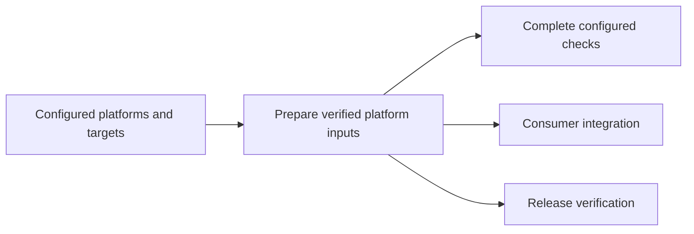

# Git hosts, CI adapters, and registries

Git transport, CI execution, and container registry management have independent capabilities. Workbench supplies GitHub
Actions and GitLab CI/CD workflow adapters. Both execute the configured target catalog and retain the same result
contract. The reference Workbench repository retains its tailored GitHub workflows; setup never replaces those files.

## Configure a destination

Create the remote repository and configure its Git remote, then preview and apply setup:

```sh
workbench ci setup --remote origin --plan
workbench ci setup --remote origin
```

Setup requires the project's existing `[ci]` platform and environment selection. It infers GitHub or GitLab from the
remote, saves a destination in `workbench/config.toml`, and creates `.github/workflows/workbench.yml` or
`.gitlab-ci.yml`. GitHub also receives `.github/workflows/workbench-platform.yml` for its shared preparation and
operation jobs. If no actionlint configuration exists, setup also creates a narrow runner-label configuration derived
from the supported platform catalog. Existing project-owned workflows and linter configuration are preserved. A workflow
previously generated by setup can be regenerated while it still matches that generator's output. Setup stages, commits,
and publishes nothing.

GitHub defaults to `ghcr.io/OWNER/PROJECT/development-BUILDER`; GitLab defaults to
`registry.gitlab.com/GROUP/PROJECT/development-BUILDER`, including nested namespaces. The existing image profiles and
immutable preparation inputs are shared. The destination changes the publication location, not those inputs.

For self-hosted servers, select the provider explicitly. Supply a registry namespace when prepared images are declared;
Workbench does not guess a self-hosted registry's domain or port:

```sh
workbench ci setup --remote gitlab --provider gitlab --registry registry.example/team/project
```

`--registry HOST/NAMESPACE` also overrides the public providers' paired defaults. For example, either CI provider may
use Harbor or another OCI registry. The generated destination is ordinary project configuration:

```toml
[[ci.destinations]]
remote = "gitlab"
provider = "gitlab"
repository = "https://gitlab.example/team/project"

[ci.destinations.registries]
native = "registry.example/team/project/development-native"
nix = "registry.example/team/project/development-nix"

[ci.destinations.runners]
linux-x64 = ["team-linux", "x64"]
macos-arm64 = ["team-macos", "arm64"]
windows-x64 = ["team-windows", "x64"]
```

The repository identity is a canonical HTTPS project identity without `.git`, independent of the Git transport URL. For
SSH aliases or a different web/API port, bind the transport explicitly during setup:

```sh
workbench ci setup --remote gitlab --provider gitlab \
  --repository https://gitlab.example:8443/team/project \
  --registry registry.example/team/project --registry-management gitlab
```

The destination stores the canonical `repository` and normalized `transports` separately. SSH usernames, aliases and
ports remain part of an explicit transport binding; additional aliases can be listed in `transports`. Unknown or moved
transports fail rather than guessing a web/API endpoint. Remote aliases may change; the push hook matches the actual
destination URL. A remote moved to an undeclared repository requires configuration before its prepared images can be
checked. Without destination declarations, the existing repository-level `ci.images` and profile registries remain
authoritative.

The Git hook passes its destination independently of Git's remote commit identity. It verifies only that destination's
published image manifests, for every configured image architecture. Manual `workbench pre-push --remote gitlab` selects
the same destination; without a remote, the manual command checks all declared destinations. No image declaration means
no registry client is needed. Availability checks never pull layers, prepare images, or publish them.

Publish a locally verified image to a destination explicitly:

```sh
workbench development publish native --destination gitlab
```

## Runner requirements and execution

GitHub workflows select the supplied GitHub-hosted runner mapping and install the declared Workbench Node runtime.
Native preparation and operation jobs also restore declared host-library prerequisites through the existing CI
provisioning script; prepared-image jobs keep those dependencies inside the image. GitLab 18.2 or newer is required for
mirrored child-pipeline results. GitLab workflows use configurable runner tags, defaulting to `workbench-OS-ARCH`, such
as `workbench-linux-x64`. The planning job uses the first configured native platform. Provision matching runners with
Node, Git, and the native SDKs and system libraries needed by the selected languages. Configure GitLab runner checkout
to preserve project symlinks and text; GitHub jobs apply the same checkout settings as the reference native workflow.
Generated GitLab commands use Bash on Linux and macOS, and PowerShell on Windows. GitHub jobs use Bash on every
platform. Windows Rust requires an initialized MSVC SDK environment. Prepared Linux targets also require Docker. GitLab
setup does not claim that arbitrary hosted runner images contain these prerequisites. Both adapters require native
execution for the declared OS and architecture; neither implicitly emulates another platform.

A consumer's workflow acquires its immutable `[tool]` Git revision before executing Workbench. Private executable
sources require read credentials on the runner. The Workbench source repository executes its checked-out launcher.
GitHub components are pinned by full commit identity, and its workflow token has read-only permissions. GitLab jobs
prefer `CI_DEPLOY_USER` and `CI_DEPLOY_PASSWORD` when supplied; provision that deploy token with `read_registry` only.
The built-in `CI_REGISTRY_USER` and `CI_REGISTRY_PASSWORD` fallback has GitLab's job-scoped read/write registry access;
its permissions are controlled by GitLab, not narrowed by the workflow. Publication remains a separate explicit
operation. Generated logins use temporary Docker configuration and remove it afterward, preserving runner credentials.
Custom registries use the runner's Docker credentials or credential helpers. Tokens are passed through stdin rather than
command arguments or generated files.

Both adapters consume the same preparation groups and operation plan. GitHub calls a reusable workflow for each group;
GitLab generates a child pipeline with explicit dependencies and mirrors its result into the parent.



Each platform/environment group prepares once. Preparation installs native tools or acquires a published prepared image;
it does not run project tests. The preparation receipt binds the exact project snapshot, configured targets and CI
destination. Operation jobs restore platform-specific tool and download caches, verify restored installations and
reacquire missing inputs. Project setup still runs in each operation's own workspace. Every configured target phase has
one operation owner; complete suites remain intact. Independent operation failures remain visible.

Prepared operation jobs restore the exact published digest and verify its image identity and current input labels.
Checks use separate offline and online network partitions where applicable. Each operation creates fresh report
directories, so earlier success cannot satisfy a later run. Failed checks retain their reports as provider artifacts.
Native platforms execute natively; missing prepared images never trigger an implicit rebuild.

`workbench ci pipeline --destination REMOTE --output PATH` generates the provider's platform plan. Add `--group ID` to
inspect that group's operation matrix. `workbench ci prepare GROUP --destination REMOTE --output DIRECTORY` creates the
handoff; `workbench ci run GROUP JOB --destination REMOTE --prepared DIRECTORY/prepared.json` consumes it. The explicit
`workbench ci target ID --destination REMOTE` command remains available for a complete individual target. These commands
complement local `workbench ci` rehearsal and do not publish archives or images.

GitHub component pins have one authority in `scripts/ci-actions.json`. Maintenance discovery updates that authority and
its derived reference workflows together. Workflow checks enforce immutable references, version comments and agreement
with the authority, including composite actions and action subdirectories. Generated consumer workflows retain version
comments and remain project-owned.

## Verification

The maintained consuming-project integration suite exercises the packaged CLI's setup preview, both providers' plans,
generated GitHub workflow lint, and a real native preparation/operation handoff in an isolated project. The normal
consumer integration role runs these scenarios in CI; release verification separately checks the packaged archive. For a
focused run from a prepared development checkout:

```sh
node scripts/check-consumers.mts --hosting-only
```

Ordinary tests and integration journeys use local fixtures and require no Git host account. To validate generated GitLab
documents against an explicitly configured server without creating a pipeline:

```sh
workbench ci validate --destination gitlab --live
```

Authenticate `glab` for the destination's API host first. The command submits both parent and child documents to the
project's CI Lint API and fails on rejected configuration. Omit `--live` for local generation and syntax validation;
local validation does not establish server schema compatibility or native runner execution evidence. Server validation
is an opt-in integration lane for environments with suitable GitLab access.

## Registry capabilities

| Registry                                                                                     | Manifest inspection, pull, push, digest verification                             | Workbench inventory and explicit deletion                              |
| -------------------------------------------------------------------------------------------- | -------------------------------------------------------------------------------- | ---------------------------------------------------------------------- |
| GHCR                                                                                         | Docker transport and credentials                                                 | GitHub API through authenticated `gh`                                  |
| GitLab, including self-hosted                                                                | Docker transport and credentials                                                 | GitLab API through authenticated `glab`, using an explicit API binding |
| Docker Hub, Quay, Harbor, AWS ECR, Azure ACR, Google Artifact Registry, other OCI registries | Docker transport and the registry's configured credentials or credential helpers | No management adapter supplied                                         |

Registry management is configured independently of CI hosting. GHCR has a known default management API; paired public
GitLab setup writes an explicit binding. Custom registries default to transport-only. For a self-hosted GitLab registry,
use `--registry-management gitlab` during setup or declare the API host and project directly:

```toml
[ci.registry_management."registry.example/team/project/development-native"]
provider = "gitlab"
host = "gitlab.example:8443"
project = "team/project"
```

Use `--registry-api-host` and `--registry-project` with `--registry-management gitlab` when the management project
differs from the CI destination. Cross-host setup requires these explicit values.

An explicit `provider = "none"` binding disables management while preserving transport, including for GHCR. A GitLab CI
destination using Harbor does not query GitLab for Harbor's inventory. Registry API hosts and projects receive strict
configuration validation, and GitLab project identities are required by the management type.

Authenticate `gh` or `glab` separately for registry inventory and deletion. `workbench cache --registry` reports
available management capabilities and access failures; `workbench prune --registry` requires the existing explicit
selection and confirmation. Unsupported registry management never prevents ordinary image transport.

GHCR deletion removes a package version, so versions carrying unrelated tags remain protected. GitLab deletion removes
only the selected prepared-image tag. Inventory and prevalidation use bounded, cancellable queries and drain active
requests before returning. Every selected identity is revalidated before any deletion; retagging invalidates the
preview. Published registry deletion is never part of automatic local cache retention. GitLab's own registry garbage
collector determines when deleted tags' unreferenced layers actually free registry storage.

Provider documentation: [GitLab child pipelines](https://docs.gitlab.com/ci/pipelines/downstream_pipelines/),
[GitLab registry API](https://docs.gitlab.com/api/container_registry/),
[GitLab CI Lint API](https://docs.gitlab.com/api/lint/),
[ECR Docker authentication](https://docs.aws.amazon.com/AmazonECR/latest/userguide/registry_auth.html), and
[Artifact Registry Docker authentication](https://docs.cloud.google.com/artifact-registry/docs/docker/authentication).
