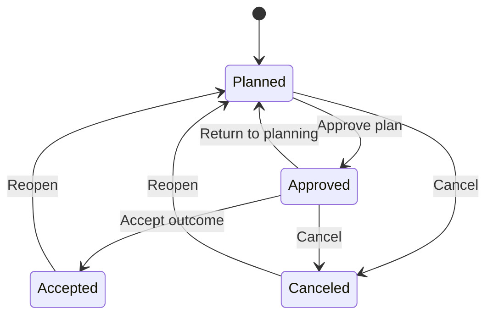

# ADR-7: Tasks and feedback

Each project-owned `TSK` record describes a coherent unit of work that may span several commits. Retain a
self-contained, searchable account of intended outcomes, evolving plans, significant decisions, and completion evidence.
Commit messages summarize individual changes. Retain finished and canceled records, including cancellation reasons, as
searchable history rather than unfinished work.

Record the task's initial authorization before its first implementation commit. Include a meaningful update to the
owning task record in every retained implementation commit. Describe the task's contribution and relevant verification
without copying commit messages. Consolidate entries when rewriting unpublished history while preserving significant
decisions and results; the account need not mirror commit boundaries or contain commit IDs. Moving unchanged records
between storage locations needs no implementation entry.

Begin with a review summary that explains why the work matters, what it delivers, and how the approach works. Keep
unresolved decisions near the top. Separate the implementation account from the plan and keep supporting
implementing-agent detail below the human-facing sections. Use visuals and delivery checklists where they clarify the
work. Keep sections proportionate to the task.

Plans adapt as questions are answered and work is discovered. Skills own planning methods. Review the current plan
before requesting human approval. Major-feature implementation requires approval of a concrete plan. When scope or
constraints change materially, pause the affected work for revised approval and retain the task's identity and completed
work. Independent approved tasks can proceed. Refinement and small repairs may continue within the approved scope.

Keep unresolved choices visible and preserve material decisions and their reasons, including significant rejected or
deferred alternatives. Distinguish agent implementation choices from human direction. Include known model and reasoning
settings when recording significant agent decisions. Update the plan as choices change and retain the reasons for
material changes. At completion, describe what was delivered, material differences from the plan, and verification
evidence; preserve enough of the original intent and decisions to explain how the outcome was reached.

Shared states are Planned, Approved, Accepted, and Canceled. Approval authorizes the current plan; acceptance records
human satisfaction with the delivered outcome and evidence. Agent claims and passing checks do not establish acceptance.

Group coherent work without imposing a linear history. Create related or child tasks when work needs independent
planning, evidence, or scheduling. Nesting expresses ownership, dependencies express prerequisites, and queue order
expresses preference; none grants approval. Preserve those relationships in discovery views. Parent completion requires
its demonstrated outcome and accepted or canceled children. Relationships reference existing tasks, allow at most one
parent, and remain acyclic. Parent records summarize child outcomes and their own integration work without duplicating
child accounts. Link related records rather than duplicating their details.

Record meaningful progress; task state remains authoritative over checklists, and acceptance requires completed steps.
Keep local execution progress separate from shared task records. Start only authorized, selected work with satisfied
prerequisites. Within an authorized batch, verified implementation may satisfy execution dependencies before human
acceptance; shared completion requires accepted prerequisites.

A developer's explicit request for a project review authorizes the investigation, verified small fixes within scope, and
recommendations. Keep the findings, evidence, and fixes together in the review task when tracked. Distinguish unverified
concerns and unexamined areas. The first local commit and outcome acceptance can proceed while follow-up decisions
remain open. Obtain approval before implementing findings that require a developer decision.

Capture personal feedback outside the repository. Triage records acceptance or rejection, reasons, and resulting record
references; unresolved feedback creates no project obligation. Keep record syntax and queue procedures in the records
guide.

Rationale: Adaptive plans preserve continuity without prematurely fixing the work breakdown. Concise overviews and
self-contained accounts support human approval and acceptance without reconstructing work from commits or local
execution state.
